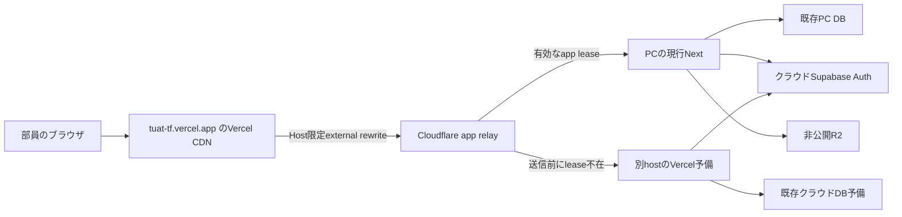

# サーバー処理のPC統一（2026-10-08）

担当: Codex。所有者の「PCに移せる処理はPC統一でいい」により、現行Nextアプリ全体をPC主系で実行する方式を準備する。画像の署名・加工、CSV解析、SSR/RSC、API、Server Actionsを個別に別実装へ書き換えず、同じアプリを使う。クラウドSupabaseの認証、非公開R2、PC DB、定期処理・予備同期は維持する。

同日の追加指示「今のURLは維持できないかな」を優先し、公開URL `https://tuat-tf.vercel.app` を維持する案へ変更した。Cloudflare直接入口の新URL移行案は採用しない。Vercel CDNのHost限定external rewriteからWorkerを経由してPCへ送り、公開originと中継originを分離する。長時間APIの120秒制約を解消せず全面切替しない。

## 基点・保全

- 既存D:\TUAT_TFの変更は前段調査でbinary patchと未追跡ファイルを退避済み。ff-only pullは既存文書の上書き防止で停止し、変更を戻していない。
- 最新origin/master `7786c34` から独立worktree `.contingency/pc-unified-worktree`、ブランチ `feat/pc-unified-20261008` を作成。作業ブランチはpushしない。
- 本番が使う元repoのnode_modulesは削除・再インストールしていない。初期の読み取り用junctionを外し、worktreeへ専用依存をlockfileから用意した。Node 24.19.0・Next 16.3.6、直接依存35件の一致を確認。実運用releaseは専用build・port・state・環境ファイルを持つ。

## 受入条件

1. 通常はCloudflareの軽い中継からPCのNextへHTTP/RSC/API/Actionを届け、画像処理と画面生成もPCで行う。認証はクラウドSupabase、本人ID/roles/RLSを維持する。
2. PCの接続先leaseが送信前に不在/期限切れなら、Vercelの同じ公開版を予備として使える。PCへ送信後の失敗では同じ保存・OAuth交換を自動再送しない。成否不明を成功扱いしない。
3. Cookie/複数Set-Cookie、公開originのredirect、CSRF Origin判定、RSC stream、画像redirectと本文を保持する。部員HTMLを共有cacheに入れない。秘密鍵・署名URL・利用者データをログへ出さない。
4. PCの新runnerは既存DB/backend/Jobsと別port・lock・state・child PIDを持ち、既存タスクやDBを停止しない。主系leaseを公開する前にNextの版・backend心拍・backup有効性を確認する。
5. PC/Vercel予備の実BUILD_ID・deploymentId・Action鍵・公開環境・OAuth callback/keyを照合する。同一commitだけで同一buildとは判断しない。実際のRSC/Action切替操作も検証する。Next 16はdeploymentId設定時にgenerateBuildIdを使わないため、BUILD_ID=releaseIdを前提にしない。
6. PC停止中のクラウドDB操作と復帰後書戻し、画像の非公開性、部分保存の復旧、初回OAuth、PWA/通知を公開前に通し確認する。合成検証を実ユーザー・実機・本番稼働確認と呼ばない。

## 実装範囲と公開境界

ローカルの専用PC runner/bridge、別Cloudflare app relay、loopback DB経路と公開origin対応、合成の受入テストを準備する。初期configはdisabled。現行REST relay、DB gateway、PC Jobsを使い回して一般公開しない。

Cloudflareを直接の公開入口にする場合は別originが必要だが、Vercel CDNのexternal rewriteなら現在のURLを維持できる。Vercelの具体的routing rule・環境変数/プラン変更は、検証した構成を提示してから確定する。費用削減方針をVercel設定変更の承認へ流用しない（AGENTS.md）。公開URLのDNSをCloudflareへ移す操作はしない。

## 用意した構成

- `ops/pc-app/`: 専用Next・gateway・Tunnelの監督、disabled config、private build manifest、専用Windowsタスクの準備。既存backend/Jobsのタスクと依存には触れない。
- `ops/pc-app-relay/`: DB用とは別の署名lease/keyで通常PCへ送るWorker。PCへの送信後には再送しない。Cookie/Set-Cookie、RSC本文、外部Google/R2 redirectを引き継ぐ。
- `APP_PUBLIC_ORIGIN`: ローカル入力でも認証redirect・Origin照合を固定公開URLへ戻す。クライアントのForwardedを公開URLの根拠にしない。PC runtimeだけserver DBを既存127.0.0.1:8000へ届ける。
- `PC_APP_RELEASE_ID`: PC/VercelのdeploymentIdをそろえる入口。manifestは実buildId/deploymentIdと公開環境・Action/Google鍵の照合値を持つ。Vercelの成果物が一致した証拠や実Action切替の代わりにはしない。
- 専用taskのmutex下でのみ、不在PIDを確認できた古い起動lockを回収する。生存/再利用PID、結果不明、壊れたlockや検査中に置換されたlockを削除しない。直接起動でのstale回収はしない。OS再起動の実試験とは区別する。
- build前に古いprepared manifestを無効化し、途中失敗した成果物を再起動に使わない。runnerのlockが残る間はbuildを拒否する。専用envだけを渡し、Next診断はACL保護したprivateファイルに保持する。

## 具体的な公開案（未適用）

利用者の入口は今の `https://tuat-tf.vercel.app` のまま。`https://tuat-pc-app-relay.track-app.workers.dev` はVercelからPCへ届ける中継先候補であり、部員へ新URLとして案内しない。Workerは未公開・未疎通。

本番切替時の具体的な変更対象は次のとおり。秘密値は記録しない。

1. 新app Workerの `APP_ORIGIN=https://tuat-tf.vercel.app` と `RELAY_ORIGIN=https://tuat-pc-app-relay.track-app.workers.dev` を分離し、専用app UUID/key・既存非公開R2を設定する。URL/Origin/Host/redirectは利用者の入口へ固定し、HTML/RSCの外部rewrite cacheを無効にする。
2. PCとVercel予備の `APP_PUBLIC_ORIGIN=https://tuat-tf.vercel.app`、`PC_APP_RELEASE_ID`、`NEXT_SERVER_ACTIONS_ENCRYPTION_KEY`、実build/Action/assetをそろえる。クラウドAuth、Google OAuth callback、既存REST Workerのoriginは現行URLを保持する。新originへの再購読/再インストールを前提にしない。
3. 予備は公開入口と異なるhostnameの、同じreleaseのVercel deployment URLを候補にする。Host限定ruleから外れること、WorkerからDeployment Protectionを通って到達できること、Vercel再entryと戻りのLocationを実際に検証する。`BACKUP_ORIGIN=APP_ORIGIN` は再帰するため拒否する。予備URLはまだ未選定であり、同じprojectでも無条件に到達できるとは扱わない。
4. Vercel Project-level Routing Ruleの候補は、Path `/:path*`、Host完全一致 `tuat-tf.vercel.app` の要求だけを `https://tuat-pc-app-relay.track-app.workers.dev/:path*` へrewriteする1本。初期段階では300秒の `/api/sheets/sync` を対象外とし、実rule testで除外とpath/query保持を確認する。公開前にstagingのrule testと隔離環境のOAuth/Cookie/RSC/保存/停止復帰を通す。全hostnameのcatch-allは予備へ再帰するため使わない。通常のNext rewritesだけではproxyの認証CPUが先に残り得るためCDN ruleで扱う。
5. Hobby利用条件と、CDN Requests/転送/予備処理の実使用量を確認後、Vercel ProからHobbyへ変更する。PCへ処理を移すだけでは月$20の基本料金は止まらず、無料枠適合も現時点では未測定。

Vercel設定変更にはAGENTS.mdの「具体的な変更についてオーナー承認を得る」を適用する。この一覧への承認はまだ得ていない。現URL維持の希望は設定をpublishする承認と分ける。

公式Project-level rulesはHobbyを含む全planで利用でき、deploymentのMiddlewareより前に動く。CDN外部rewriteの経路でPCへ直接送る要求にはVercel Nextの画面生成/Function処理を不要にできる。ただしCDN要求/転送は残り、Free適合は実測で確認する。前段調査の月間単純推計は約69万CDN requests・9.48GB Fast Data Transferで、Hobbyの100万requests・100GB以内の候補。外部rewriteのFast Origin Transferを0と実測確認したものではない。

外部rewriteの最大120秒と、現行 `/api/sheets/sync` のmaxDuration 300秒は別の制限。Worker/bridgeの期限を300秒以上にしても入口の制限を延長できない。初期案ではこの手動APIは元のVercel経路へ残し、既にPCで動く定期同期はそのまま使う。HobbyのFluid Computeは現行公式で最大300秒だが、対象projectの有効設定と残るCPU使用量を確認する。手動同期もPCへ統一する次段階は結果確認/復旧条件を整理して別途検証し、成否不明で再送しない。対応前に全面一括rewriteを公開しない。

参照: [external rewrites](https://vercel.com/docs/routing/rewrites)、[Project-level rules](https://vercel.com/docs/routing/project-routing-rules)、[全plan対応の発表](https://vercel.com/changelog/vercels-cdn-now-supports-updating-routing-rules-without-a-new-deployment)、[proxyの120秒制限](https://vercel.com/docs/limits#proxied-request-timeout)、[Hobby](https://vercel.com/docs/plans/hobby)。

現行DBと同じQuick Tunnel方式を用意した。Quick Tunnelには200同時request・SSE非対応・稼働保証なしの制約があり、長時間稼働/実RSCを確認せず安定運用済みとしない。所有ドメインを使うNamed Tunnelへ変える場合はドメインの費用と別の設定確認が必要。

## 検証と進捗

- 専用依存で環境差確認、TypeScript、対象eslint成功。Vitest全体125ファイル1115テスト成功後、公開URLの新規受入12シナリオを追加し、関連4ファイル27テストを再確認した。
- Nodeの受入53テスト成功。偽Next/loopback HTTPと合成WorkerでCookie、公開Host、RSC初期chunk、redirect、保存後切断時の1保存・0予備再送を確認。失敗/部分buildのmanifest無効化、起動lockの拒否/回収も含む。
- workerd/一時R2は外向きfetchを全て合成serviceへ置換し、6群8要求を確認。実Cloudflare・実Auth・実DBでの検証ではない。
- 検証で見つけたPCポートのredirect残留、NextのBUILD_ID前提、RSC開始後切断の下流待機を修正した。
- incoming requestキャンセルを扱うWorker flagを明示した。合成upstreamへキャンセルを伝え、予備へ再送しないテストも通った。実Cloudflareでのキャンセル伝播は未確認。
- 専用taskのPowerShell 5.1/7構文解析に成功。実タスクの登録/起動、OS再起動は未確認。
- ローカルcommit `b1c8549666c5468c0cb5f74b9282cb763e781d29`（38ファイル、Co-Authored-By Codex）を作成。作業ブランチは `feat/pc-unified-20261008`。
- そのcommitで、本番の鍵/DB/Authを使わない合成envの実Next production buildに成功。実BUILD_ID/required-server-files/manifestを使った `run.mjs --check` も成功し、enabled:falseのままサーバーを起動していない。
- 専用PC依存のnative Sharpで合成64x64画像を32x32 WebPへ縮小・変換できた。実画像の権限/保存/削除の一連の確認は別途必要。

本番の起動/停止、公開先・環境変数・料金設定、DB・migration、既存定期処理には変更なし。実運用envでのNext release build、Vercel予備との成果物照合、実OAuth/画像保存、PC停止中の保存から復帰・書戻し、PWA/通知の実機、圧縮stream、無料枠使用量は未確認。準備コードを移設済み・無料化済みとは報告しない。作業ブランチはローカルのみでmaster反映・push・Production deployなし。

合成build後の結果追記は文書のみで手元に保持し、次のコード変更と一緒に扱う。文書更新のための再build・deploy・pushは行わない。

## 現URL維持の追加検証

所有者の追加希望に合わせ、canonical APP_ORIGINと中継用RELAY_ORIGINを分離した。保存Origin・NextのHost・Cookie/Set-Cookie・redirectは現URLへ固定し、公開入口と同じ予備先を拒否する。Vercelのrouting metadataは予備へ持ち込まず、外部rewrite cacheを無効にし、HTML/RSCのCDN向けcache指示もprivateにする。

Node受入55テスト、対象eslint、diff --check成功。APP=https://tuat-tf.vercel.app、RELAY=合成workers.devを分けた隔離workerdで6群9要求が成功した。実VercelのHost条件によるrouting、cache、Deployment Protectionを通る予備、再入場、PC停止復帰は未検証。Vercel/CDN設定・本番DB・OAuth・料金には変更なし。変更はローカル作業ブランチのみでpushしない。
現URL維持のローカルcommit: 152bb0dc7b0072a4256119ffe807da01be7b57ad。作業ブランチのみ、master反映・pushなし。

## 本番切替の可否確認（20:08 JST）

担当: Codex。所有者の「もう本番実装しても問題なさそう？」に対し、実装済みの合成検証と実運用の準備を分けて再確認した。全員向け切替は現時点では保留。

- 既存PC backendは読み取りstatusでmaintenance:false・healthy:true、20:07:51の心拍と19:59:33のバックアップ完了を確認。新appのVercel予備や新経路の安全性を確認したことにはしない。
- 新appの想定production env/release/stateは未作成。Worker設定はdisabled、app instance/bucket/予備URLはplaceholderのまま。実サービスの公開・設定変更・DB変更はしていない。
- 必須の未確認は、VercelからWorker/PCへの実routingとCookie/OAuth/RSC/保存、PCとVercel予備を往復する既存tabの保存・cache/権限、停止中の予備保存と復帰書戻し、routingの差戻し。preview URLが本番の認証やDBを共有するだけの環境は隔離試験と呼ばない。
- 合成buildと55受入テストは準備の根拠であり、実通信・本番用環境・実機の証拠にはしない。120秒制限に合わせたシート同期除外と、予備への到達/Protection確認も公開前に必要。

次は本番へ切り替えずに実経路の検証準備を進め、受入条件の通し確認後に具体的なVercel設定変更と公開を判断する。Hobbyへの変更・無料枠適合は公開判断と分け、稼働後の使用量を確認する。この追記は文書のみでローカル保持、push/build/deployなし。
