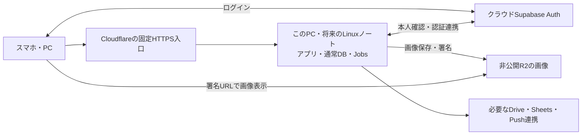

# PC集約の最終改善案（2026-10-11）

> 10/20の統合時注記: 以下は移行前の履歴です。現行構成・開発基準は[一本化記録](UNIFIED-DEVELOPMENT-2026-10-20.md)を参照してください。当時の非公開資料は元の作業場所に保全し、この統合版へ複製していません。

現在の結論は、PCにアプリ・通常データ・定期処理を集約し、クラウドSupabase認証と非公開R2を維持する方針。優先する追加改善は、結果不明の保存を照合する仕組み、backup/復元の引継ぎ、実行権限と秘密の分離、認証の一時制限への対応。アイコン署名7日/cache6日は維持し、性能は実測して改善する。

**調査で必要と判断した改善の候補実装・ローカル保存・合成検証は完了。本番への反映・切り替えは未実施。** 最終候補は `1bfa4427c36073018339a32047660d670323a734`、公開版 `8949a6a` を取り込み済み。全1,485アプリテスト、206 migrationの暗号化DB復元、最新候補のbuild/28項目の模擬HTTP確認が成功した。運用integration222件/通常ops61件は運用コードが共通の旧候補で成功済み。実構成の残条件は別に確認する。最新証拠は末尾の終了記録にあり、途中の成功・失敗記録も保持している。

最新候補は `D:/TUAT_TF_RELEASES/precutover-1bfa442` に独立配置済み。旧 `precutover-a695286` は保持。内部 `.git`、専用Node24、独立依存、コード/依存のhashとWebP処理を確認した。これは公開コードと依存の準備で、本番用設定・専用accountの管理ACL・本番用build receiptは未完了。

| 最終改善内容 | 候補で確認できたこと | 本番切替前に残ること |
| --- | --- | --- |
| 構成の簡素化 | PCへアプリ・通常DB・Jobsを集約する候補。cloud Auth・非公開R2を維持 | 旧業務予備の保留照合、唯一のwriterと公開入口の切替 |
| 保存・Sheetsの結果照合 | 結果不明・部分成功を永続保持。再読込み後の重複作成防止。既知IDのDB登録だけ修復。正当な編集・削除を保持 | 実GAS/Googleと物理的な送信先の確認、未知結果の内容照合 |
| バックアップ・復元 | 保存前の完全inventory/容量確認、未知intentの予約、暗号pair再検証、保持dryRun。復元後も権限と保留を保持 | 実target/鍵の独立回収・容量/保持の有効化・別媒体復元 |
| 認証・権限 | 検証済み本人IDと現在権限。429など一時失敗で有効cookieを消さない | 実OAuth・初回登録/許可取消を最終公開入口で確認 |
| 実行権限・秘密 | 固定commit/環境/依存の照合、privateファイルと実行主体の検査、別targetを拒否 | 専用account/S4U・WSL/DB/秘密の境界・端末暗号化 |
| 画像と表示 | 非公開R2を維持。結果不明で参照画像を消さない。入力容量/処理期限を制限。アイコン署名7日/cache6日維持 | 実スマホで写真・一覧表示・回線変更・PWAと速度を確認 |

## 開始

担当: Codex。所有者の「他にも改善点を調査して最終的な改善内容をまとめて」に対する読み取り調査。アプリ本体・通常DB・定期処理はPCへ集約し、認証はクラウドSupabase、画像は非公開R2を維持する。停止中の継続利用を優先しない最新指示を反映し、アイコンURLの一律短縮は採らない。

対象は現行公開コード・PC集約候補の終了記録・最新RLS/ログイン許可リスト・運用と画像配信。既存変更を保全し、実装済み/準備済み/未確認を区別する。今回は本番DB・秘密値・実ユーザーデータを読まず、コード・本番設定・稼働サービスを変更しない。受入条件は根拠のある追加改善と、撤去対象・維持対象・公開前確認をまとめること。

## 最終構成案

以下は切替候補。現在の本番入口はまだVercelで、固定Cloudflare URLは未確定。

- Cloudflare固定HTTPS入口からPCのNextアプリへ通常アクセスを集約する。DB管理口・Studio・Docker管理口は公開しない。ドメイン/hostnameは未確定。
- PCではアプリ本体・通常DB・既存Jobsを運用し、後に同じ構成をLinuxノートへ移す。Jobsは同じアプリの処理を使い、実行主体とjournalを一つにする。既存タスクを先に止めない。
- クラウドSupabase AuthとGoogleログイン、非公開R2画像・暗号化バックアップ、必要なDrive/Sheets/GAS/Push連携は維持する。
- PC停止中の継続利用を必須としない。業務データの予備・自動切替・書戻しは撤去対象。ただし現行の未解決書込みとmirror-stateを照合し、クラウド業務書込み停止を確認してから撤去する。
- Authユーザー/本人ID・プロフィール作成・外部メール許可リストの連携は業務予備から分離して維持する。外部許可ユーザーの初回ログインからPC側データ操作まで確認する。
- アイコンの署名7日/転送キャッシュ6日は当面維持する。投稿/ノート画像とは区別し、一律の15〜60分短縮・公開cache化は採らない。
- 長期署名の既発行URLは期限内に利用でき、許可取消でそのURLや端末内cacheを即時無効化したとは扱わない。新規取得の拒否と、既発行URLの寿命を区別する。期限を変更する場合は転送cacheも署名期限内へ合わせ、実測で表示速度を確認する。

## 調査基点・確認済み

2026-10-11にorigin/masterをfetchし、読取基点は `0f253bb`。最初の通常fetchは.git/FETCH_HEAD書込み権限で失敗し、許可された昇格fetchで成功。元の多数の既存変更は戻さず、コードはgit show origin/masterで照合した。作業checkoutを最新公開版と取り違えない。pull/merge/resetは実施しない。

- 10/11 RLS監査の終了追記では、管理ロール/本人管理列/特権RPC/匿名経路/R2署名の部員確認は本番是正済み。今回その本番カタログ・実端末を再確認してはいない。
- アイコンはgetUser、許可判定、approved確認、R2 HEAD、署名、307の経路。URL差替えとprivateキャッシュは既存。Avatarはdecoding=asyncだが一覧外の画像も一律に読み込む実装。
- image-storageのアップロード容量確認は各回のR2全object一覧取得。現件数での待ち時間は未測定。容量判定をなくす案は採らない。
- sheets/headerはfetchPublicMember経由でforceParse:trueの全CSV解析を使用してから見出しだけ返す。OB live refreshは表示中・online・dialogなしで30秒ごとrouter.refresh。
- avatar POSTは新画像保存→profiles更新→旧画像削除。更新error/返却0件の分岐で新画像を削除する。応答不明でDBだけ更新済みになる事象は未再現だが、結果照合なしの補償削除がコード上にある。
- 画像のbyte上限とWebP再変換は既存。投稿/ノートは明示pixel上限があり、avatarはsharp既定の上限を使用。全body取得後のbyte確認があるため、PC公開入口でもbody上限・処理期限を確認する。
- cloud-mirrorは業務予備だけでなくAuthユーザー両方向連携とlogin_email_allowlistを扱う。予備撤去でスクリプトを丸ごと停止しない。
- 10/4品質改善には隔離環境で検証済み・本番未公開の保存/競合/未保存改善がある。最新masterとの差分を確認して必要分だけ統合し、再実装しない。

## 優先する改善

| 優先 | 内容 | 完了を判断する確認 |
| --- | --- | --- |
| 集約前 | 業務予備と認証連携の分離。PCを唯一の業務書込み先にし、旧予備保存と書戻しを段階撤去 | 未解決変更を照合、新規大学/許可外部ユーザーの本人ID・profiles・RLS保持、取消後の既存セッション拒否、二重Jobsなし |
| 集約前 | アイコン保存の結果不明時には画像を消さず、プロフィール参照を再取得して照合。旧画像削除失敗と保存失敗を区別 | 応答不明・部分成功・他端末更新でも現参照画像を消さない。再送/孤児清掃は照合後のみ |
| 集約前 | 本番専用実行ユーザー・専用依存/build/env、最小公開口、秘密アクセス制限 | 開発/AIユーザーから本番秘密/DBが読めない境界、DB管理口非公開、一般操作は本人JWT/RLS、特権は専用用途 |
| 集約前 | 公開入口でbodyサイズ/timeoutを制限し、画像処理のpixel/同時数を実機容量に合わせる | 正常写真と既存連携を保持し、大きい入力や集中処理を安全に拒否。RSCをbufferせず、Origin/Cookie/複数Set-Cookieを保持 |
| 集約前 | 固定releaseの起動・更新・切戻し、OS自動起動、暗号backup・別機復元 | 古いタブ/Server Action/PWA、再起動後、更新途中失敗、過去版への復旧。復号鍵と回復キーは別保管 |
| 次 | アイコンの再取得を計測し、重複認証/HEADを必要な範囲で減らす。画面外の一覧アイコンだけlazy候補 | 初回/再表示/新cookie/別ユーザー/取消を分けて時間測定。必要な権限確認・キャッシュ分離を保持 |
| 次 | R2容量確認の全object走査をアップロード毎の経路から分離する候補 | 期限付きの容量集計＋保守的余裕を検証。並行保存・集計失敗時に容量判定を飛ばさない。正確な課金上限とは呼ばない |
| 次 | シート見出し専用解析、OB更新を変更有無確認/部分更新へ絞る | 日付列・元column index・保存前列照合、30秒以内の変更反映、編集中保護を維持。通信量削減とCPU削減を別測定 |
| 次 | 画像障害・取得障害と「未登録」を区別し、個人データを含まない診断へ | 実不存在だけ404、依存障害は503等。生例外・メール・本文・署名URL/秘密をログへ出さない。API障害後の再取得で表示復旧 |

getClaims候補は署名検証済み本人IDの取得に限り、現在のapproved・許可取消・ロール照合を省略しない。非対称署名時はAuth通信を減らせるが、アカウント最新状態の照合との違いを保持する。

管理アカウントの二段階認証、PCディスク暗号化、依存/OS更新は維持・導入状況を確認する。今回実機設定は未調査。新しい独自認証・全機能の全面再設計・永続オフライン送信待ち・一律の画像期限短縮は追加しない。

## 根拠と公開前確認

- [最新RLS修正記録](RLS-SECURITY-REVIEW-2026-10-11.md)、[ログイン許可リスト](LOGIN-ALLOWLIST-2026-10-11.md)、[PC本番運用](../ops/laptop/PC-PRODUCTION-HANDOFF.md)、[PC集約候補](PC-COMPUTE-ROLLOUT-2026-10-09.md)、[Linux試験終了記録](SURFACE-SERVER-TRIAL-2026-10-10.md)。過去の合成試験を今回の本番/実機証拠にしない。
- 同梱Nextのself-hostingガイドと[公式self-hosting](https://nextjs.org/docs/app/guides/self-hosting): 入口でのpayload/timeout保護と、release更新時のversion skew・streaming・Origin確認。
- [Supabase getClaims](https://supabase.com/docs/reference/javascript/auth-getclaims): 署名方式によるネットワーク通信の違い。[OWASP upload](https://cheatsheetseries.owasp.org/cheatsheets/File_Upload_Cheat_Sheet.html): 画像再変換・容量・処理負荷の制限。

最初に別origin/セッション/合成DBで一連操作を確認する。本番切替前には通常ログイン/保存/削除/写真/Drive同期/Push・PWA・旧タブ・再起動/復元を必要な実端末で確認する。PC停止中の予備閲覧を受入条件へ再追加しない。公開URLは変更の有無を具体化し、OAuth/リンク/PWA影響を確認。Vercelの具体的設定/契約変更は検証後に内容を提示する。

## 終了

調査・最終改善案の作成を完了。新規案は静的コードと公式資料の照合で、性能測定・障害再現・本番実操作・実端末試験は今回実施していない。時間や削減率を確定値として報告しない。アプリコード・DB・秘密・本番サービス・公開設定・課金は変更なし。文書と索引だけをローカル保持し、commit/push/build/deployなし。

## 切替前準備の開始（同日）

所有者の「本番切り替えはまだだが、切り替え前の状態までは持っていって」を受領。今回は切替候補のコード・独立release・起動/検証・復旧/切替手順まで進め、公開URL・本番DB・現行タスク・課金を切り替えない。受入条件は、最新masterの機能/本人ID/権限を保持したPCアプリ、必要なクラウドAuth/R2/外部連携、単一Jobs、業務予備なしの経路、失敗時の安全性、再現可能なbuildと更新/復元、公開前確認を具体的成果物で照合すること。準備成功と本番反映を区別する。

既存pc-unified/local-minimal候補を独立レビュー中。最新masterをfetchして差分を照合し、既存候補を丸ごと上書きせず必要な部分だけ継承する。担当を分け、画像保存、候補の再利用、主担当の運用/経路準備を並行する。現行rootの既存変更・node_modules・WSL/DB・mirror-state・Jobs journalを保全。

## 切替前候補の実装・合成確認結果（同日）

独立checkout `D:/TUAT_TF/.worktrees/pc-precutover-20261011`、branch `feat/pc-precutover-20261011` に候補を固定。再fetch時も基点origin/masterは `0f253bb`。候補の最終local commitは `fe6ef54328046117295d2753e965eb31b9933b2c`（主実装 `3cbdb23` とWindows wrapperの構文修正）。master統合・push・Vercel/Cloudflare公開・本番DB/認証設定・課金変更は行っていない。元checkout・古い候補・既存node_modules・WSL/DB・タスク・mirror-state・Jobs journalを保全した。

### 候補へ実装した内容

- 明示的なPCアプリ設定時だけ、クラウドAuthとPCの通常データを分離する。ブラウザは同じ公開originのREST入口、Server ComponentはPC内部loopbackを使用。業務データのクラウド予備・自動再送・R2への接続先通知はこの経路で使用しない。従来公開の設定がオフの場合は既存経路を維持する。
- callbackで許可判定後、署名検証済み本人と同じUUID/emailのPC側Authをその場で確認・準備する。検索障害を未登録扱いせず、作成応答不明は一回だけ照合する。新しいAuth同期は業務mirrorから独立したdry-run/target snapshot/journalを持ち、既存プロフィール・ロールを上書きしない。実ユーザーへの適用は無効。
- shared-pc Jobsは同じNextを使用し、もう一つのNext常駐を作らない。release識別、schema-only REST、既存backend heartbeat/backupを確認する。現行journalとactivateAtの継承を必須にし、未解決保存を再送しない。新タスクは未登録・未起動。
- avatarを比較付き更新にし、応答不明では参照を一回照合して画像を保持する。普通のプロフィール保存からavatar_url更新を除去。note画像登録不明も補償削除しない。実不存在は404、依存障害は503に分け、生例外・パス・署名URLをログへ出さない。署名7日/private cache6日は維持。
- uploadをbyte/30秒・avatarを明示pixel上限で制限し、R2容量走査も既存inventoryの8秒/100ページ制限を使用する。容量判定の迂回は行わない。
- loopback公開gatewayでOrigin・body/期限・内部/hop headerを検査。本文上限内の完全受信後だけ一回dispatchし、応答はstreamingを維持。複数Set-Cookieとcanonical Hostを保持し、切断/timeoutで再送しない。
- 固定commit・専用依存・env・buildのreceipt、二重起動lock、標準Nextのdrain/親死亡時の子終了、無効Task XMLの準備を追加。新規private parentを秘密/identity bytesの前に保護し、既存の他者明示権限/junctionを拒否。現在実行者のACL確認であり、本番専用accountによる開発/AIとの隔離を確認済みとは扱わない。

**画像保持の制約:** 古いタブによる参照復活と遅延commitを守るため、avatar差替え/削除ではDB参照だけを変更し、退役objectを保持する。旧note cleanup queueは確定削除と旧補償削除を区別できないため、全queue/objectを保持し件数だけ診断する。容量計算には保持分も含まれる。恒久的な清掃完了ではなく、確定した世代/参照とtransactionを照合する清掃が残る。

### 確認した範囲

| 確認 | 結果・範囲 |
| --- | --- |
| 環境/型/対象eslint | Node24.19.0、直接依存35件のlock一致、tsc成功、eslintエラー0。既存ProfileEditFormの内部ログアウト遷移警告1件 |
| 全Vitest | 146 files / 1266 tests成功。初回はsandboxのTemp rename権限でテスト開始前に失敗し、専用checkout内TEMP/TMPで解消 |
| 運用試験 | test:ops48件、test:ops:integration69件成功。専用loopback・合成本人情報・private ACL・owned childだけを使用。最初のfixtureポート衝突は自分のfixtureを終了して解消 |
| 実build | webpack production build成功。commit `fe6ef54` / releaseId `pc-review-20261011-r2` とreceipt、起動後versionの一致。最初のbuild中にwrapper構文を修正したため、その旧commitのreceiptは作らず再build |
| built Next HTTP | login/匿名redirect/本人データ/合成プロフィール保存/他Origin保存拒否/local Auth・特権JWT拒否/許可取消/cookie更新を確認。PKCE callbackは正しいJSON形式のverifier cookieで一回交換し、同UUID照合・canonical redirect・Set-Cookie2個を確認 |
| 障害・起動 | fake PC取得先停止で503、fake cloud Auth継続、cloud業務APIへの呼出し0。二重起動拒否、host停止drain成功、同固定build再起動、無効Task XML作成成功。実S4U起動/OS再起動ではない |

合成試験ではCloud Auth/DB/画像/Sheetsを実サービスから独立させた。実PostgreSQLのRLS、実Google・Drive・R2・Push、実端末/PWA、backupの別媒体復元を証明するものではない。終了時に今回所有する合成host/APIだけを停止し、candidateを無効へ戻した。最終checkoutはclean。試験のprivate env/log/receiptはGit外へ保持し、公開Gitへ入れていない。

### 切替直前の完了に残る条件

1. **固定の無料公開入口とhostname。** 最新の既存Cloudflare調査は管理ドメイン0件、最終hostname未確定。所有ドメインの有無を質問中。Named Tunnelか無料workers.dev案の到達経路を確認し、新originのSupabase Site URL/redirect allowlistとリンク/PWAを具体化する。ドメイン購入・Vercel設定変更は行っていない。
2. **Driveの正規sourceと実効設定の照合。** Drive OAuth sourceのpathは既存候補でも未特定で質問中。秘密の貼付けは不要。HTTPS callbackと既存token暗号鍵/stateを保持する。Pushの専用sourceは既知だが現在Edgeとの秘密値一致、R2の読取/書込/停止/容量フラグの現在値一致は未証明。例のtrue/falseを本番値として使わない。
3. **本番専用account・配置境界・回復手順。** 開発/AIから本番秘密/DBへ届かない実ACL/アカウント、ディスク暗号化・管理MFA、実OS自動起動/再起動、暗号backup/keyの独立保管、別媒体/別機の復元を確認する。build receiptの範囲はsource/lockfile/Node/env/.nextで、runtime依存全バイトの真正性を証明しない。
4. **通常操作と定期処理の移行受入。** 実端末のログイン・通常保存/削除・実写真・Drive/Sheets同期・Push/PWA・旧タブを確認。業務mirrorの未解決変更とJobs journalを照合し、Auth/allowlist連携を分離してから旧書込み/書戻し/二重処理を停止する。未解決の主要操作を残して切り替えない。

一覧アイコンのlazy化/重複Auth・HEAD削減、R2容量集計の分離、シート見出し解析とOB更新量削減は次の性能改善候補として保持する。今回は広い方式変更を追加せず、初回/再表示/別ユーザー/許可取消/並行保存を計測してから採否を決める。

時間の目安は、公開URLと正規設定が揃った後の実連携・端末・再起動/復元確認に**半日〜1日程度**。設定情報/利用者確認の待ち時間は別で、不一致や復元失敗があれば延びる。確定した作業時間や性能削減率ではない。

この段階の終了は候補コード・合成build・起動準備まで。本番反映0、切替前準備の全体目標は上記の実確認が残るため継続中。候補運用手順（当時のローカル資料: `../.worktrees/pc-precutover-20261011/ops/pc-host/README.md`）はローカルcheckout内で閲覧できる。文書は今回の一本へ追記し、既存索引の項目を維持した。

## 切替条件の追加確認（同日・継続）

専用候補で独立PostgreSQLの現行migration/RLS試験、実行依存の改変検出、専用Windows accountの配置検査、確定した画像の整理を準備する。受入条件は、未確定の保存や古いタブを原因として使用中の画像を削除せず、実行前に依存/プラットフォーム変更を拒否し、開発accountのまま本番用taskを準備済みと扱わないこと。本番DB・R2・既存task・mirror/journalは変更しない。

実機の読み取りでは、現行Backend/Jobs taskはいずれも開発accountと同じprincipal。候補用 `TUAT_PC_App` accountは存在しない。候補の無効XMLも開発accountで作った合成試験の記録であり、専用accountでのS4U起動を証明しない。Windows BitLocker APIからC:/D:の状態を取得できず、暗号化済み/未暗号化のいずれとも判定していない。回復キーは取得していない。

`manage-bde -status` もWindows側でC:/D:の状態取得を拒否したため、暗号化確認は未完了のまま。専用accountの検査候補はNode/PowerShellとreleaseの変更権限、config/env/stateの読取り権限、上位directoryの置換権限を調べ、同じ開発principalを拒否する。本番WSL/DBの所有と管理権限はこのapp検査だけでは分離できず、引き続き配置時の確認事項。

### 追加改善の実装・検証終了

候補の追加commitは `62d17874fe5d6056b19eea8191bbb8e36da2d4c1`。latest `origin/master` は引き続き `0f253bb`。候補branchだけへローカル保存し、master統合/push/公開/課金/本番サービス変更は0。

- **実行前の照合:** receipt v2はGit管理ファイルの実バイト、実行時node_modules（root `.cache`のみ除外）、public、Node実行ファイル、OS/architectureを束ねる。改変・古いreceipt・別platformを拒否。Git/Windows権限用commandは固定path、PATH上の代替を使わない。Windows依存をLinuxへ流用せず、Linux側で別install/build/receiptを作る。
- **Windows起動候補:** preflightは選んだ専用accountのtokenで実行し、管理者所属・開発account共用・helperの別checkout・第三者の秘密読取り/コード変更を拒否する。無効Task XMLを作る前とTask起動時に同じ検査をする。実在しない専用accountの試験成功とは扱わず、前回の開発account用無効XMLは旧合成試験記録として保全。
- **確定画像の整理候補:** 新しい冪等migration `20261011150000` にtransactionを跨ぐpath単位barrierを追加。最後の参照削除が確定したpathだけを対象にし、共有中の参照を保持。閉鎖後の復活を防ぎ、R2削除まで7日10分待つ。署名7日/cache6日は維持。新RPCにも許可取消/未承認拒否を付ける。旧queue・未知upload・旧Supabase Storage objectは対象外で、容量計算から消えない。workerは手動候補・既定無効でJobs/cron/taskへ登録していない。旧署名/書込み経路を撤去しPC入口の330秒上限を確認するまで有効にしない。
- **独立DBの証拠:** 新規専用PostgreSQL17に公式Auth77本/Storage67本の初期schemaと候補201本の全app migrationを適用し、新migrationを再適用。既存role/profile・RPC/note・新画像・許可リスト/UUID/取消の4 SQL suiteと、実2session競合4件が成功。旧cleanupを含む合成fixtureは最後に0件、cron無効、R2/provider要求0、今回作成したcontainer/volume/internal networkのみ照合して削除。JWT署名自体はSQLの合成claims試験では証明していない。証拠（当時のローカル資料: `../.worktrees/pc-precutover-20261011/ops/pc-host/db-review/result.json`）のmigration SHAは `67913e9a0ea016dbbdf5d6249b077f171add59e5b833458375d4f79b40cc14d3`。

最新候補でenvironment（Node24.19.0/直接依存35件）、tsc、対象eslint、全Vitest **146 files/1,269 tests** が成功。運用integration **97成功・Linux専用1skip・失敗0**。既存の通常ops48件は前段で成功し、この追加変更では対象が変わっていない。

新しい合成専用state `pc-precutover-synthetic-20261011-run3` で `pc-review-20261011-r3` をbuildし、commit/releaseId/receipt v2の一致を確認。built Next HTTP12項目（画面・本人ID・保存・cookie更新・権限拒否）と、PC API停止→503/cloud Auth継続/業務cloud fallback0を確認。通常写真・R2実通信・実OAuth/Push/PWA・実端末速度の証拠ではない。合成Next/gatewayはdrainして終了、mockも終了、設定は無効へ戻した。停止後のreceipt再照合が成功し、OSのTCP一覧で4試験portのlistener0を確認。秘密を含むstate/envはGit外だけへ保持。

**残条件は縮めない。** 固定無料URL/所有domain、Drive正規設定の所在、新originのOAuthと実連携/実端末、実R2/Push実効設定、専用accountとWSL/DB境界、OS自動起動/再起動、暗号化と別媒体復元、旧mirror/journalの未解決照合が残る。情報/設定が揃ってから半日〜1日程度の確認作業を想定するが、domain/OAuth/人の応答待ちと未発見不具合の時間は含まない。今回のコード・合成build・独立DB準備は終了、本番切替前の全体目標は継続中。

## 公開入口・現行Jobs・復旧の追加調査（同日・継続）

本番切替前の目標を継続し、実PostgRESTによる署名/RLS、合成DBの暗号backupから別DBへの復元、独自domainなしの固定Cloudflare入口を独立担当で確認する。既存本番の停止/設定変更や終了済みSurface試験の再開は行わない。

### 独自domainを使わない入口候補

2026-10-11の公式資料では、固定 `workers.dev` → Worker VPC Service → Named Tunnel → PC loopback gatewayの経路を構成できる。VPC Serviceの設定がTunnel/host/portを固定し、HTTPのHostはWorkerからのrequest URLに由来する。独自domainと公開TunnelのDNS ingressは技術上の必須条件ではない。従来の「所有domainがなければ固定入口を準備できない」という制約を更新する。

ただし[Workers VPC料金](https://developers.cloudflare.com/workers-vpc/platform/pricing/)は**beta期間中**すべてのWorkers planで無料という説明であり、恒久無料を保証しない。[workers.dev](https://developers.cloudflare.com/workers/configuration/routing/workers-dev/)は個人/趣味/非critical用途を想定し本番にはcustom domainを推奨する。[無料Workersの制限](https://developers.cloudflare.com/workers/platform/limits/)はaccount全体100,000 requests/日・10ms CPU/request。[Tunnel要件](https://developers.cloudflare.com/workers-vpc/configuration/tunnel/)には最新cloudflaredと外向きUDP7844/QUICがある。仕様上の候補と、実account/networkを通した動作を区別する。

ローカル候補だけを準備し、beta条件・割当hostname・API制限・実cookie/OAuth/Server Actions/streaming/upload/PC停止を受入条件とする。公開accountやWorker/VPC/Tunnel/DNSは今回作成/変更しない。[公式private API例](https://developers.cloudflare.com/workers-vpc/examples/private-api/)と[Service動作](https://developers.cloudflare.com/workers-vpc/configuration/vpc-services/)を根拠にする。

### 現行の移行元を読み取った結果

既存 `TUAT PC Jobs` taskの参照先を読み取ると、現在の設定は既存backendのconfigを使用し、releaseは `4f553abd41577f845a959474c24481f113f16c6d`。今回の候補releaseとは異なる。stateは既存 `backend/pc-jobs-state`、activateAtは `2026-09-27T06:32:55.1620921Z`。schedulerと同じJavaScript Date.parseでjournalの `1790490775162` と一致を確認した。PowerShell日時変換の初回比較は小数精度の丸めが異なり不一致になったため、schedulerの変換に合わせて訂正した。設定やjournalは書き換えていない。

読取時、program/cleanupはsuccess、sheetsはfailed/HTTP200、sheetWritesUncertain=false、sheetWritesBlocked=false、過去のsheet failure記録4件。HTTP200だけで日次処理の成功とは扱わず、履歴を新journalで消さない。本文・部員名・失敗理由の実データは出力していない。

taskの名前ではなくSIDで照合し、`TUAT PC Backend Temporary` と `TUAT PC Jobs` はいずれも現在の開発accountと同じSID、権限はそれぞれLimited/Highestと確認。前段のJobsの名前文字列比較は表記が異なるためfalseになったが、account分離の証拠に使わずSID比較で訂正した。存在しない短縮Backend名の読み取りは失敗したため未取得と扱い、installerの正確な名称で再確認した。

現在taskが指定するenvと既存sync env/deployed JSONにもDrive OAuth3項目は存在しない。正規sourceのpathは引き続き未確定。task envのR2 read/write=true・image readOnly=false・Sheets enabled=trueは読取確認したが、Vercel/Edgeの全実効設定やR2容量設定との一致を証明したものではない。Push/envの専用sourceもtask envへ統合済みとは扱わない。

クラウド側の既知設定から `failover_changes` をHEAD/count=exactだけで読取。00:11:15 UTCの全件17、00:12:30 UTCの再試行上限5以上の保留17を確認。個人行・秘密値は表示せず、DB書込み/再送/削除は0。mirrorを停止していないため同時点transactionの照合ではなく、各時刻の観測値。成功のmirror statusだけで保留0とは判定できない。切替前に対象snapshot/dry-runとPCの確定状態を照合する条件を追加し、一括再送やqueue破棄で解消しない。

### 中継撤去とbackupの依存

既存 `run-backend.mjs` は中継/endpoint公開/業務mirrorのほか、起動時と15分間隔の暗号backupを実行している。shared-pc Jobsも同runtime heartbeatと35分未満の検証済みbackupへ依存する。新hostにはbackup/WSL起動の継承がまだないため、旧backendを一括停止するとbackupとJobsのready判定が失われる。候補READMEへ、DB/WSL起動・定期暗号backup・検証済み別場所保存・失敗保護を維持する主体を決めて確認するまで撤去しない条件を追加した。旧heartbeatの架空更新やbackup期限除去は採らない。

通常保存のPC専用経路も内部RESTへ直接接続し、旧gatewayのmaintenance/backup鮮度判定を通らないことをコードで照合した。Jobsだけの停止で保護を継承済みとは扱わない。新backup主体と通常REST/Server Actionの書込み保護を接続し、backup未完了/35分超過/状態取得不明の保存拒否と正常復帰を検証することを切替条件へ追加した。このfail-stopの接線はまだ実装/実試験していない。

既存backupはpublic/auth/storageのdumpと、dump hash/instanceに結び付いたVault/Push/cronの暗号復旧資料を持つ。一方、固定release/env、現在cloud AuthのJWT信頼設定、認証専用sync state、Jobs journal、R2画像bytesの全体復元をそれだけで証明しない。現在のSERVER-HANDOFFにも旧PC Auth前提をそのまま適用できない注記がある。新しい合成復元試験は本番データや実R2を取得せず、暗号形式と別DB復元の範囲だけを確認する。

### 署名を含む実APIの隔離試験結果

新しい `db-review/run.ps1 -Api -Execute` は、前回のSQL/race結果を保持して `api-result.json` へ別に記録する。新規owned PostgreSQL/公式Auth・Storageの初期schema/候補201 migrationと、固定PostgREST14.12をinternal network・公開portなしで用意。fictitious ES256/HS256 signerの実JWTを検証するHTTP31項目と本人UUID/profile保持のSQL確認1項目が成功した。

正しい署名、誤署名・claims改変・期限切れ・未来の発行・別audienceの401拒否、本人更新1件/他人0件、権限昇格403、複数roleのOR、非公開noteの閲覧範囲、service専用権限、未承認avatar RPC403を確認。管理者が許可を取り消した後、同じ既存JWTの取得/保存/definer RPCはいずれも拒否。既存migrationのpre-request/RLS/本人helperを模造・差替えしていない。

最終fixture各表0・cron無効・今回所有するAPI/PG/container/volume/networkのcleanup成功を確認。JWT/試験鍵/passwordをGit/ログへ残さず、R2/provider/本番への要求0。cleanup更新後に新規fixtureで再確認した最終API driver SHAは `9fc240df3c1bc56fab6f20677d9b7d70bacc65b0e652fcc3cfa49df790a6fd99`、cleanup helper SHAは `0c8ddce0a82da2cb18c0cb9226d0f9e46fe4e7b5874d029fbe2e80ac26590983`。証拠（当時のローカル資料: `../.worktrees/pc-precutover-20261011/ops/pc-host/db-review/api-result.json`）はschema/driver hashとassertionだけを保持する。

これで「SQLへclaimsを注入しただけ」の制約を狭めたが、実cloud signer/JWKSの配布/rotation、Google callback/初回ユーザー作成の実HTTP、公開入口/実端末、外部連携/定期Jobsは未確認のまま。起動設定の初回失敗を修正して新規fixtureで再検証し、失敗したattemptを成功として合算しない。

Cloudflareのローカル入口候補は `ops/pc-host/cloudflare` の7ファイルへ限定し、設定placeholderは意図通り拒否する。模擬bindingによるrequest/response/stream/cookie/Origin/再送なしの16項目と対象eslintが成功。実Cloudflare resources/account/connectorを作成・変更した証拠ではない。

### 最終改善内容の優先順

| 優先 | 最終内容 | 現在の状態 |
| --- | --- | --- |
| 切替前必須 | PCを唯一の通常データ/アプリ/定期処理の本体にし、cloud Supabaseは認証、R2は非公開画像/暗号backupへ役割を絞る | 候補実装・build/HTTP/実DB権限を確認。旧予備の保留17件とAuth連携、backup/WSL起動/単一Jobsの引継ぎ後に旧中継を撤去 |
| 切替前必須 | 結果不明の保存を再送せず照合し、参照中の画像を補償削除しない。本人JWT・DBのRLSで権限を守る | 候補実装。画像競合/署名付き実APIの隔離試験成功。実ユーザー/通常端末の一連操作は残る |
| 切替前必須 | 専用実行account、保護した固定release/依存/env、管理口の非公開、管理MFAとディスク暗号化の確認 | 検査/固定receipt候補は実装。現在のWindows taskは開発SID共用で、専用配置・WSL/DB境界・暗号化は未確認 |
| 切替前必須 | 暗号backupと、認証API設定・権限・鍵・env・journalを含む復旧手順を整える | 旧backendがbackupを所有する依存を確認。別の合成DB復元試験を追加し、現行cloud Authの冷間起動条件は個別照合 |
| 切替前必須 | 固定公開入口、新originのOAuth/Drive/Push/PWA、再起動・更新・切戻しを一連で確認 | domainなしWorker VPCのローカル候補と16試験成功。beta限定無料。正規設定と実account/connector/端末確認は残る |
| 性能計測後 | 一覧の画面外avatar、重複Auth/HEAD、R2容量走査、シート見出し解析、OB refreshを必要な範囲だけ減らす | 候補を調査済み。速度/CPU/通信量の実測前に一律変更しない |

アイコンは署名7日/転送cache6日を維持する。表示負荷と署名期限の問題を分けて測り、性能改善を先に理由なく期限短縮へ置き換えない。PC停止時の書込み予備・自動書戻し・永続送信待ちは最終構成へ追加しない。

時間の旧目安「半日〜1日」は正規設定が揃った後の実連携/端末確認の枠である。今回判明した保留17件の内容照合、backup/WSLの引継ぎ、専用account配置は別に必要で、内容未確認のまま総工数を確定しない。設定/人の応答待ちも作業時間と区別する。

### 合成暗号backupの復元試験終了

新しい `ops/pc-host/backup-review` の7ファイルだけを担当し、現行本番のexporter/scheduler/handoffは変更していない。2026-10-11 00:25:07 UTCの合成証拠（当時のローカル資料: `../.worktrees/pc-precutover-20261011/ops/pc-host/backup-review/result.json`）では、固定cached Auth77/Storage67/候補201 migrationから作ったsourceを、既存3-schema custom pg_dump/同じTUATPC01 AES-GCM形式のDB・復旧資料pairとして暗号化・ローカルreadbackし、別の新規PGへownerを維持して `pg_restore --single-transaction --exit-on-error`。合成95表/148行の全column/UUID、62 public RLS表、table/policy/function/trigger/schema owner・ACL/column ACL/default ACL/constraintの8区分が一致した。

合成Vault1件を復号値から再暗号化し、合成Push envと3件のcronを停止状態で復元。本人保存・不許可session・許可取消・画像barrierの復活拒否を実SQLで確認し、受入操作はrollbackした。誤鍵・改変・別instance・別dumpのpairは復元前に4件拒否。専用Node試験4件と既存暗号試験3件、対象eslintが成功。今回のowned container/volume/internal network/一時archiveのcleanup成功、本番/R2/provider要求0。rootから7 Node試験の再現も成功。

cold targetで不足する `authenticator` のPostgREST pre-requestを実際に再現し、レビュー済みの `public.check_login_access` だけを設定・照合した。またpublic schemaを完全に再作成した際のinitdb既定PUBLIC USAGE欠落を再現し、source owner=`pg_database_owner` と一致するschema USAGEだけを明示復旧。追加table/function権限やRLS緩和ではない。これらはplatform roles/extensionsとともに**archiveとは別のcold初期条件**で、既存2-file backupが単独で保持するとは報告しない。peer reviewで広いACL確認をschema/column/default ACLへ拡張してから一致を確認した。

run SHA `652d0d897a6328b33e335b01e429a31396836ea28c3e44f2d842fd2019a0bc7f`、復元SQL SHA `f1dbbb29becee76749a0138ace5efcaaabb4a30a7b3dd123e12cd43b988e3c43`。当初のtable/functionだけの比較を全ACL一致の証拠へ読み替えず、上記の最終結果を採用する。

同host上の合成復元であり、現行本番backupの完全性/最新catalog、実R2 download、別媒体/端末、実cloud signer、実Push/画像、OS再起動の証明ではない。復旧手順候補（当時のローカル資料: `../.worktrees/pc-precutover-20261011/ops/pc-host/backup-review/README.md`）に、host/env/暗号鍵・JWT信頼設定・Auth/Jobs journal・画像本体・同時点snapshotの不足と手順を明記した。

### 今回の保存・終了状態

追加候補をlocal commit `5da3830199c06ee6a6358c55e78d68a356bfb59c` へ保存。直前fetchでもorigin/masterは `0f253bb`、候補checkoutはclean。元checkoutの既存変更、node_modules、本番WSL/DB、task、mirror-state、Jobs journalを保全し、master統合/push/deploy/公開/課金/本番切替は0。

fixture作成の応答不明で残ったresourceをcleanup済みと報告しないよう、DB-reviewは作成前にattemptを記録し、正確なname/ID/owner/generation/image/internal network/no ports/pathを確認・削除・不在再確認する。unknown/list/inspect/remove失敗はcleanup未完了。21 fake adapter試験が成功。変更したPS→Node接線を実Dockerでも確認するため最後に一度、新規API fixtureだけを実行し、00:28:31 UTCに201 migration/HTTP31+SQL1/fixture0/cron無効/実cleanup成功を確認。旧SQL/raceの `result.json` はbyte単位で保全した。

root確認ではCloudflare16、backup/crypto7、cleanup21の専用Node試験と変更対象eslintが成功。最終API driverと証拠のSHA一致、API/backup成功とcleanup、2つの合成JSONの秘密らしい文字列0を確認。App/DB migrationの変更は今回追加しておらず、前段の全Vitest/tsc/environment/実buildを今回の運用試験で別の実機証拠へ読み替えない。Appの直近build/receiptは `62d1787` に束縛されるため、新commit/最終実envのrelease準備時には新receiptをbuildして照合する。

調査・今回の隔離検証とローカル保存は終了。本番切替前目標は、新backup主体/通常保存のfail-stop、保留17件のsnapshot・照合、正規Drive/Push/R2実効設定、新origin/実公開入口/実端末、専用account/WSL境界/暗号化、OS自動起動と別媒体復元が残るため継続。主要未確認を残して切り替えず、旧予備/中継/backup/Jobsを準備中に停止しない。

## Backup引継ぎ・通常保存の保護・保留照合の準備（継続）

最新origin/masterをfetchして候補と照合し、既存本番を維持したまま独立候補だけを進める。コード照合で、PC専用REST、Server Action、service-role、およびDB更新前に行うR2/GAS/Sheetsの直接変更が旧中継のbackup判定を通らないと判明した。実利用者操作で障害を再現した報告ではない。

受入条件は、親hostが単一backup supervisorを所有し、毎起動のinstance/generation/startedAtと正確なDB targetに結び付いた新しい暗号backup pairを確認すること。20秒心拍・120秒期限、35分以内backup、future/別generation/対象不明を拒否し、起動直後・失敗・停止・復帰で通常保存と定期Jobsを同じ根拠に合わせる。cloud Authと読み取りを継続し、保護時に外部providerへ変更を送らない。旧中継/mirror/taskの実停止や設定変更は行わない。

旧failover保留の照合はGET/HEAD限定、対象・schema・件数・同時更新を確認し、元queueと関係するPC行だけをGit外のprivate directoryへ暗号化してsnapshot/dry-runする候補を作る。17件のattempt上限到達を成功や空queueへ変換せず、再送/ACK/削除はしない。column一致だけでtriggerやcross-rowの副作用完了を断定しない。

公式[Supabase Authの制限](https://supabase.com/docs/guides/auth/rate-limits)も再確認。token endpointはIP単位の既定150回/5分（burst30）、user等の対象は既定30回/5分で、429を返す。PCへserver処理を集約すると同じ外向きIPに集中する可能性があり、検証済みgetClaims・重複refresh抑制・429時のcookie保持を対象コードで照合する。実projectの設定値や実負荷は未取得で、未知のforwarded headerやservice-roleによるIP偽装は追加しない。

### 追加調査で確定した改善と残条件

- **認証の一時制限でcookieを消さない。** 同梱Auth SDKの合成HTTPで、期限切れrefreshに429を返すとcookieが削除されることを再現した。候補はcloud Authのrefresh POSTに限り、確認済み429をretryableな503へ扱い直し、同じclient内の失敗cooldownでproviderへ再送しない。成功POST・不明なnetwork結果を共有せず、invalid grantのcookie削除は維持。実SDKによるSSR/browser cookie保持、provider dispatch1、署名済みJWTによる復帰を確認。429本文は3秒/16KiBで制限する。SDK内部の約25.4秒待ちと、その終了後のSDK側60秒cooldownは残り、即時表示回復や全client間の負荷削減を証明したものではない。
- **backupを中継から分離し、同じ状態で保存とJobsを守る。** hostが単一supervisorを所有し、新generationの暗号pair確認までは書込みを拒否する。Auth/読み取りは起動できる。状態不明・期限超過・未来日時・別generation/DB・停止は保護へ倒す。R2/GAS/Sheetsの直接変更も送信直前に検査し、保護時のprovider dispatch0を合成試験で確認。新backup候補は対象照合/暗号pair/新規conditional PUT/readbackを備えるが、実WSL target・起動account・容量/retention・別場所復元を確認していない。旧backendを撤去できる状態とは扱わない。
- **外部成功とアプリ保存を区別する。** Sheetsの新規作成が確認済みで後続format/DB登録が失敗した場合は、既知のURLを保持して部分成功を知らせる。同じ画面内の再作成を止める。最初の作成結果不明も明示し、再作成を促さない。ただしreload後の照合にはdurableな試行記録が必要で、現在のUI状態だけで永久に二重作成を防ぐとは報告しない。R2変更はSDK attempts1、読取りは2を維持する。
- **Sheetsの結果不明から後日の再送へ至る経路が残る。** `push-record`のGAS結果不明と、GAS成功後のDB送信済みmarker失敗/0件を明示し、追加のpending更新や即時再送はしない。一方、保存時点のDB triggerが既に立てた `pending_sheet_push=true` を後続plannerが再送対象にする。これは未解決アプリ内容をCSVで上書きさせないフラグでもあるため、単にfalseへ消せない。結果不明/送信済みmarker不明をdurableな試行記録へ残し、plannerが照合前の再送を除外する対応が**切替前の未実装条件**。routeの `retryable:false` は呼出元の手動再送を止める指示で、schedulerからの除外済み証明ではない。
- **旧保留の照合は暗号snapshot候補まで準備。** GET限定の件数/順序/schema/同時変化検査、数値精度を保持した比較、Git外private directoryへの暗号pair保存を実装し、合成private disk/ACL/readbackを確認。column一致でもtrigger/cross-row副作用の完了は未確認にする。実17件の行取得/snapshot/ACK/再送/削除は行っていない。

追加の実PC読取りでは、既知stack内のDB/PostgRESTとDB system identifierの関係を確認した。ただしtaskから実supervisorへの所有関係、loopback8000 publisherからRESTへのrouting、最終heartbeatの鮮度はこの開発tokenで証明できなかった。statusのhealthy=trueだけでreadyとせず、別同名DBで検証を代替しない。実backup鍵・個人行・providerは取得せず、本番service/task/設定を変更していない。

**最終の優先順:** ①単一PC本体とAuth/R2維持、②画像/外部保存の結果不明を照合して再送しない仕組み、③backup/復元/retentionの独立所有、④専用account・秘密/DB境界・管理MFA/ディスク暗号化、⑤固定入口/実OAuth/連携/再起動を含む一連受入、⑥実測に基づく画像/認証/一覧/シート取得の性能改善。署名7日/cache6日は維持する。PC停止時の書込み予備・書戻し・端末送信待ちは追加しない。

### 現候補の保存・確認

追加63ファイルをlocal commit `139e73ce23d6afadc4e43d7e23a10b5051d55c25` へ保存。origin/masterは `0f253bb`、候補checkoutはclean。environmentはNode24.19.0/直接依存35件のlock一致、tscと変更対象eslintが成功。全Vitestは **150 files / 1,347 tests成功**。初回6件の失敗は、safeな結果不明errorと確定run receiptを扱う新しい境界に旧fixtureの期待が合っていなかったため、送信数/禁止hostの検査を保ったままfixtureを修正し、receipt保護/0件更新の2件を追加して全体を再実行した。失敗した初回を成功へ合算しない。

今回の運用integrationは **172成功・2skip・失敗0（全174項目）**。skipはLinux固有npm内部linkと、Git外private directoryの明示設定を要する暗号disk試験。後者は別にWindows上の合成private disk/ACLで16項目成功を確認しており、重複分を174件へ加算しない。hostのbackup lifecycleはowned合成Next子/状態fileだけ、backup supervisor/providerはfake adapter、retirementは合成queue/行だけを使った。本番backup/実17行/実連携/実端末の証明ではない。

同じcommitのR4をprivate合成設定だけでproduction buildし、receipt v2/commit/releaseIdの一致とbuilt Next HTTP **28項目**、prepared receipt **1項目**を確認した。通常保存・本人データ・cookie更新・権限拒否に加え、maintenance/旧generation/別DBの保存拒否はPCへのdispatch0、読み取り/cloud Auth継続、正常状態への復帰を確認。PCデータAPI停止は503、cloud業務fallback0を保持した。backup attestationとPC/Auth APIはmockで、実WSL/本番backup/providerの証拠へ読み替えない。

R4 host/Next/gateway/mock listenerをowned drainで終了し、config disabled・runtime stopped・lock不在・receipt再照合・source不変を確認。Windows TCP一覧でも4試験portのlistener0を確認した。診断logはprivateかつ合成key/cookieを伏せ、実本番envやcredentialを使っていない。合成結果（当時のローカル資料: `../.contingency/pc-precutover-synthetic-20261011-run4/result.json`）を本番の通常操作/速度の証明にはしない。

主checkoutの既存変更と依存・本番WSL/DB・mirror-state・Jobs journalを保全し、master統合/push/deploy/公開/課金/本番切替は0。旧backend/Jobsを停止していない。今回の追加調査・候補実装・合成build/HTTP・ローカル保存は終了。上記のSheets再送・実target/設定・復旧/retention・account/暗号化・新公開入口/実操作が残るため切替前全体目標は継続し、完了扱いにしない。

### Sheets再送を閉じる次段階の具体案（未実装）

既存backup対象のpublic schemaに一般ユーザーが直接操作できない `sheet_push_attempts` とbegin/finish RPCを追加する。送信本文や秘密・新しい送信待ちpayloadは保存せず、record/attempt ID、元のupdated_at、対象設定・送信先/セル内容のfingerprint、状態、確認時刻、marker結果を保持する。record/profileと対象を照合して `reserved` をcommitしてからGASへ一回送信し、begin不明ならattempt IDで確認、確定できなければdispatch0。未解決のrecordと同じtarget slotを重複拒否する。

成功確認後はfinishで `confirmed` と、版/対象が同じ場合だけpending解除を同transactionで保存する。marker失敗や応答不明、begin後のcrashでは予約を維持し、期限で自動解除/再送しない。旧送信中の新編集はpendingを保持する。plannerはCSV保護のexcludedDatesを維持した上で未確定pushを除外し、確認済み同一送信はmarker修復だけを行う。新送信も同じbeginを通し、Jobsのcadenceを増やさない。

受入条件は、二重begin・結果不明・成功後marker失敗・各crash境界/再起動・同時編集・照合失敗で再送0、CSV保護保持、backup/restore後もbarrier保持。新時刻migration/型/receipt helperと既存push/planner/routeの対象差分に限定し、返信・削除キューを今回案の完了範囲へ含めない。この段階は読み取り設計だけで、DB/table/RPCや候補commitへ追加していない。

### 継続開始: シート送信の永続照合とバックアップ保持の調査

候補commit `139e73c` は開始時clean、再fetchしたorigin/masterは `0f253bb`。実操作の障害再現ではなく、上記の定期再送経路をコードと合成試験で確認した修正として着手する。recordと日付欄の消去を同じwriteCells予約で守り、結果不明を期限で解除しない。新版・削除・設定変更後も元の日付をCSVから保護し、既知の成功時だけ同じ版のpending/clear queueを原子的に解消する。providerへ送らないclear解消は別の版照合RPCに分ける。

DB receiptはPCの外部送信証拠であり、旧mirror/failover再送対象へ追加しない（除外理由: 予備で生成/上書き/書戻しするとPC唯一の送信主体と不明結果のbarrierを破壊するため）。既存public schema暗号backupに含める。検証は全migrationを適用した新しい隔離DBでRLS・原子的marker・再起動/編集/削除/同時送信を確認し、本番migrationやprovider操作は行わない。

保持処理は旧retentionを接続せず、まず検証済みpairだけを対象にする純粋なdry-run候補を独立実装する。実receipt記録・容量予約・削除への接続は未実装条件として残し、legacy/部分保存/不明結果を削除候補へ入れない。

追加照合で、GASの `writeCells` は保護された数式などのセルを省略しても `success:true` を返すことを確認。`protectedHeaders` も部分成功として保持する。また[Google公式](https://support.google.com/docs/answer/183965?hl=en)では公開シートの自動更新に数分かかる場合がある。公開CSVが空というだけでclear queueを消すと、実シートに残った古い内容が後に復活する可能性がある（本番での障害再現ではなくコードと遅延条件からの推論）。今回の候補は再作成したDB recordがある場合だけ送信なしでqueueを解消し、CSV空/行なしだけならqueueと取り込み除外を保持する。実シートの行有無と消去を一度で照合するprovider契約は未実装の切替条件として残す。

### 追加改善の統合・検証結果

今回の追加22ファイルをlocal commit `f5c9ee43808b4957cc9129e887a377bd4f4323bb` に保存。保存直前のfetchでもorigin/masterは `0f253bb`、保存後の候補checkoutはclean。主checkoutの既存変更・依存、本番WSL/DB、task、mirror-state、Jobs journalを保全した。master統合/push/deploy/公開/課金/本番切替は0。

**シートの二重送信を防ぐ候補。** `sheet_push_attempts` とservice専用begin/finish RPCを追加し、手動送信と定期plannerのwriteCellsが同じ予約を通る。一般ユーザーは試行表を直接読書きできない。版・profile設定・実際の送信内容・物理的な日付欄を照合して予約を確定した場合だけ一度送信する。予約後の停止、GAS結果不明、marker保存不明、部分成功では予約を保持し、時間経過や後続Jobsで自動再送しない。新しい編集・日付移動・削除・設定変更があっても元の日付のCSV取込みを保護する。既知の完全成功だけ同じ版のpending/clear queueを原子的に解消し、新版は未送信のまま維持する。

`protectedHeaders`/未対応見出しを含むGAS応答も部分成功として保持する。削除時はアプリDBでの削除成功とシート削除未確認を区別し、未確認時だけ既存toastへ知らせる候補。CSVの空/行なしだけではqueueを消さない。DBに同日のrecordが再作成されている場合の送信なし解消も、同じ日付欄の並行送信予約をDB内で照合する。実GASへの行有無・消去の原子的な要求は未追加で、実PWAのtoast表示も未確認。

この試行表は旧mirror/failover対象から明示除外し、PC唯一の外部送信証拠を予備が上書きしない。既存public schemaの暗号dump対象には含まれるが、今回追加した試行表を含むbackupの復元・別媒体移送はまだ検証していない。新規workbook作成、返信、未使用の旧 `reconcileOnSwitch` 等の全外部書込みへ今回の証明を広げない。

**バックアップ保持のdry-run候補。** `ops/pc-backup/retention.mjs` は検証済み暗号pairと明示した容量情報だけから保持案を計算する純粋関数で、常にdry-run。現generationの保護pair、直近local24/remote96、JSTの過去30日の日別最新pair等を保持し、legacy・途中保存・結果不明は削除候補から除外する。対象不明、容量不明、未来日時、重複identity、過大inventory、数値overflowなどでは候補/容量判定を拒否する。実receipt永続化・容量取得/予約・supervisor接続・削除は未実装。旧retentionは停止・置換していない。保持案だけで費用上限や実削除の安全性を証明しない。

**今回の検証。** Node24.19.0/直接依存35件のlock一致、tsc、変更対象eslint、diff checkが成功。全Vitestは **152 files / 1,389 tests成功**。運用integrationは **全187項目中185成功・2skip・失敗0**（skipはLinux固有npm内部linkとGit外private directory指定が必要な暗号disk試験）。保持案の13試験は185件に含まれる。以前の合成試験件数と足し合わせない。

新しい隔離PostgreSQLへ全202 migrationを適用し、権限・完全/部分成功・marker trigger失敗のrollback・null/欠落設定の区別・新版保持・削除・再適用のSQL確認と、**別セッション8ケース**が成功した。8ケースは7件の実lock競合と、予約を残して新しいsessionから再開する1件で、OS再起動の証明ではない。同じ日付欄を参照する別profileの二重送信と、送信なしclear解消との競合も確認した。別profile同士のCSV snapshot競合の全パターンをDBだけで証明したものではない。

最初の隔離試験はfixtureの再適用パス誤りで終了し、実owned resourceのcleanupを確認。パスを修正後、別の新generationで全体をやり直して成功した。失敗したattemptを成功に合算していない。成功generation `31f25fef420543d9a0e7189089492ee3`、synthetic DB system identifier `7695218334308180002`。provider要求0、fixture残存0、cron無効、今回所有するcontainer/volume/internal networkの削除・不在確認が成功した。本番DBへmigrationを適用していない。

隔離DBの成功receipt（当時のローカル資料: `../.contingency/pc-sheet-push-review-20261011/sheet-push-result-31f25fef420543d9a0e7189089492ee3.json`） SHA256は `990bc339c6a0ed1938c4dc628e3e40db34ead18b7edf5dea177b55a757bd01cd`。migration SHA256は `bef2e672c544d322a2b9fac2536181006ba26b726f8159ec936f9b319473fd69`、受入SQLは `4dc1051d63a898323318f1486d17f954128928cc21a11c10b2a2ecd1162aa844`、race driverは `49943bb4e9b1cd023ab8d5cf8f2340c6926ae4f0e0fd25db1167354899539be1`。

| 最終改善 | 候補で準備できたこと | 本番切替までに残ること |
| --- | --- | --- |
| 構造の簡素化 | アプリ・通常DB・Jobsを単一PCへ集約し、Auth/R2の役割を分離する候補 | 旧予備17件のsnapshot/照合、実Auth連携と単一Jobs/backupの引継ぎ |
| 保存の信頼性 | 画像参照の保護、結果不明の無条件再送停止、シートwriteCellsの永続予約 | 実GAS clear契約、新規workbook作成のreload後照合、実一連操作 |
| 認証と権限 | 一時429でcookieを保持、本人JWT/RLS/許可取消の隔離実API確認 | 実cloud signer/Google callback、project設定、実利用負荷 |
| バックアップと復旧 | 単一supervisor・新generationの保存保護、合成復元、保持dry-run | 実target/鍵/容量・保持接続、追加試行表を含む別媒体復旧 |
| 実行環境の保護 | 固定release/依存/env、公開口の制限、専用accountの検査候補 | 実account配置とWSL/DB/秘密の分離、管理MFA・disk暗号化の確認 |
| 入口と性能 | Cloudflare入口候補、アイコン署名7日/cache6日維持、測定対象の整理 | 実公開入口/OAuth/Drive/Push/PWA、再起動/切戻し、速度・通信量の実測 |

**新commitのbuild/起動確認終了。** privateな合成R5でproduction build、既存28 HTTP配線とprepared receipt1項目が成功。同じ `f5c9ee4` / release `pc-review-20261011-r5` のreceipt再照合・source不変を確認した。PC/Auth APIとbackupの状態はmockで、新しいSheets receiptのHTTP処理、実WSL/backup/provider、実利用者/PWAの一連操作を証明しない。設定disabled、合成backupの保護、owned hostのdrainとruntime running=false、mock listener終了、runner lock不在を確認。Windows TCP一覧でも18180/18181/18200/18201のlistener0だった。直接build childの通常終了を確認し、強制終了は0。worker子孫の全停止は別途証明していない。

最初の実行はsandbox内のTCP確認が4portともEACCESとなり、保守的な事前検査で停止した。attempt/新build receipt/host lockは存在せず、build・listenerは未開始。昇格したread-only TCP一覧で4portにlistenerがないことと、config disabled/新SHAを確認した後、初回拒否を別fileへ保存して合成実行だけを明示的に再許可した。実行開始後の不明結果を無条件再試行する変更ではない。以前のR4 receiptは旧commitの証拠として保全し、新commitの検証へ流用しない。

R5成功結果（当時のローカル資料: `../.contingency/pc-precutover-synthetic-20261011-run5/result.json`） SHA256 `6343855094298018f908467a755112dfd3a38a80679c9d9229a4ffda8b7a18da`、prepared receipt `4db3545d0a60418df247006f0eeb87b937697d29d5b956c4907fc0b73b47fabf`、private driver `fd5509683abccb449086f10e9d8111184291410aa3f930f177c1a6513b5fad9d`。保存した初回拒否は `19c137ae207cd70d9c889d3601c5fb53cb27309e451685c02d4fa5399e59ad6f` のまま。

今回の追加改善・ローカル候補保存・全テスト・隔離DB・新buildの確認は終了。本番は未反映で、最終表の実GAS契約/作成照合、旧保留、実backup/保持/復旧、専用account/秘密境界/暗号化、正規入口/OAuth/連携/実端末の確認が残る。旧backend/Jobs/mirrorを準備中に止めず、全体の切替前目標は継続する。工数の目安は正規設定が揃った後の接続・端末確認が半日〜1日。保留17件の内容照合、専用環境配置、実backup保持/別媒体復旧は別枠であり、待ち時間を含む総工数は現時点で確定しない。

### 継続開始: 残る切替前準備の具体化

前段は追加候補22ファイルと隔離DB/新buildの成功証拠を残した進捗。今回は fresh fetch/現candidate clean `f5c9ee4` と最新停止指示を確認して開始。本番切替とSurface再開はしない。

担当を分けて、①GASの実シート消去契約とアプリの一回送信/永続予約、②新しいシート試行表を含む合成暗号backupの実復元、③Windows専用実行account/配置の非秘密調査を進める。rootはbackup supervisorの試行記録/完全readback証拠を永続化する候補を担当する。受入は、CSV遅延に依存しない消去確認、存在しない日付行を作らない、protected/未対応項目の部分成功保持、旧GAS/不正応答の完了扱い禁止、予約/marker/新版保護が復元後も維持されること。Apps Script内のlockをGoogle UI/別scriptの排他保証へ読み替えない。

backupはdump/外部保存前に試行を記録し、両暗号objectのサイズ/hash/ETag/readbackと最後のtarget確認後だけverified receiptを保存する。結果不明や中途記録を保持し、旧backup receiptや既存鍵/namespaceを置換しない。保持plannerの容量取得・予約・削除接続は別の残条件として区別する。実DB試験はrootがdriver/cleanupを確認してから新しい所有資源のみ起動し、旧証拠を上書きしない。本番DB/秘密/資格情報/ユーザー行、GAS公開、provider、旧service/taskの変更は0。

### 現行スキーマの暗号バックアップ復元を確認

新generation `685b1af1792f4d2eb2b4d124cb82f797` で、全202 app migrationとAuth/Storageの既定migrationを適用した合成DBを暗号dumpし、新しい隔離PostgreSQLへ復元した。96表・162合成行のUUIDを含む全行、schema/RLS/ACL/function/trigger等8区分のmetadataが一致。今回追加した5件のシート試行記録について、実anon/authenticated/service roleの権限、結果不明・部分成功の保留、完了marker、新しい編集の保持、同じ日付欄を共有する別profileの送信拒否を確認した。復元後の再送許可は0。

SQL確認はrollbackし、再度全行一致を確認。今回所有するcontainer/volume/internal networkのみ削除して不在を確認し、暗号pairも残していない。driverのtimeout/出力上限/強制終了など結果不明はcleanup成功へ変換しない。成功receiptは `success=true` / `cleanup=true` / `commandOutcomeUnknown=false`。本番DB・実ユーザー行・R2・GAS・providerへの操作は0。同一PC内の合成復元であり、実本番backupや別媒体・別機復旧、OS再起動の成功には読み替えない。

新しいprivate復元結果（当時のローカル資料: `../.worktrees/pc-precutover-20261011/ops/pc-host/backup-review/.private/685b1af1792f4d2eb2b4d124cb82f797/result.json`） SHA256 `11410dbbf0ce5848a6f673adedad8ceda6095c7dfe5dc127c84c530ee70b575c`。driver SHA256は `2a2b1db0fdc287b2e43bb4ee706a3b6982b62845052c5cb7f50231055a6b399d`。従来のtracked結果は変更せず、前後/currentとも `fc6a82120170606de8f1697191e96de700a8eda7088508346be95e0cbf81f1a9` を維持した。

### 最終改善内容の追加準備

今回の候補28ファイルをlocal commitへ保存した。保存直前のfresh fetchでorigin/masterがOB戦の追加更新 `a497d99` へ進んだため、保全branch `backup/pc-precutover-before-latest-master-20261011` を残して全候補commitを載せ直した。競合なし、最新候補HEADは `a6d1e976be96b7e8dc6660a07a0590f2c3ea1fbc`。主checkoutの既存変更は操作せず、作業branchのpush、master統合、公開、本番切替は0。

**シートの消去確認。** 新しい `clear-if-existing-v1` 契約は、実workbook/sheet/headerのmetadataを読み、DB予約後に消去を1回送る。対象日付がない場合は行を作らず、実シートからの厳密なmissing応答で確認する。CSV空欄・反映遅延・取得失敗で削除予定を誤って解除しない。数式/日付/曜日/週合計/計算距離を保護し、未対応・保護項目の省略を部分成功として保持する。旧GAS、別attempt/送信先/列の応答、flush失敗、結果不明は完了扱いにしない。通常writeCellsと同じscript lockに参加し、既存の送信上限・JST cadence・CSV除外を維持した。Google UI/別scriptの同時編集は保証外。GAS未公開とlegacy defaultの実workbook ID照合は残る。

**バックアップの保存証拠。** dump前にprivateな試行記録を排他的に保存し、両暗号objectのkey/サイズ/hashを保存前に記録する。R2のHEAD/GETで同じETag・サイズ・hashを確認し、最後に同じDB実体を照合してからverified receiptを永続化する。途中停止、アップロード不明、最後の記録失敗は保留として残す。既存archive鍵/instance namespaceを維持し、秘密値をreceiptへ保存しない。純粋な保持plannerへ渡せる形式だが、実inventory・容量取得/予約・削除への接続は行っていない。

**本番実行環境の検査。** Windowsの継承専用ACEを現在の実効権限と区別し、子fileへの実効書込みは引き続き拒否する。本番releaseは保護された内部 `.git` を持つstandalone配置を要求し、外部/共有metadataやinclude/filter等を拒否する。commit/実byte hashを調べるGitには開発者のglobal/system設定・環境overrideを渡さず、現在のWindows CRLF正規化を固定して維持した。実専用account/S4U、保護release/Node配置、WSL/DB/秘密の境界、disk暗号化の確認は未完了。既存Dドライブの広い書込み権限や開発ユーザー所有VHDXを独立した本番境界として受け入れていない。

| 優先 | 最終的な改善 | 現時点の状態 |
| --- | --- | --- |
| 先 | PCへアプリ・通常DB・Jobsを集約し、クラウドAuthと非公開R2を維持 | 候補準備。本番は現行構成 |
| 先 | 保存結果を照合し、参照中の画像削除・不明結果の自動再送を防ぐ | 候補と合成確認。実端末の一連操作が残る |
| 先 | シート送信/削除の永続予約と実消去確認 | 候補と隔離DB/VM確認。実GAS反映/送信先照合が残る |
| 先 | 暗号backupの保存証拠、復元後の送信保護 | 合成復元成功。実target/容量/保持/別媒体復旧が残る |
| 先 | 本番実行ユーザー・秘密・固定release・公開口の分離 | 検査候補。実account/WSL/DB/秘密境界と管理MFA等が残る |
| 次 | アイコン署名7日/cache6日を維持し、不要な画像取得・R2一覧走査・画面全体更新を実測して削減 | 期限変更なし。速度/通信量の実機計測と性能変更は別段階 |

最新master取り込み後の全Vitestは **153 files / 1,420 tests成功**、tsc成功。運用integrationは **全197中195成功・2skip・失敗0**、通常opsは **61成功・失敗0**。environment/対象eslint/diff checkも成功。opsのskipはLinux固有npm内部linkとGit外private directory指定を要する暗号disk試験で、別の専用合成試験の成功と件数を合算しない。最新OB migration追加により、全203 migrationでの復元と新commit専用R6 build/HTTPも別generationで確認する。

**最新masterを含む復元も成功。** 新generation `7053580d048a4ba6ad67603c208a8cca` で全203 migrationを使用し、8区分metadata・96表162合成行・5 receiptの一致と、実role権限/不明結果保持/再送許可0/新編集と同日slot保護を再確認した。受入SQL rollback、全行一致、所有資源の不存在、暗号pair除去、候補cleanを確認。再試行は0、`success=true` / `cleanup=true` / `commandOutcomeUnknown=false`。新しいprivate結果（当時のローカル資料: `../.worktrees/pc-precutover-20261011/ops/pc-host/backup-review/.private/7053580d048a4ba6ad67603c208a8cca/result.json`） SHA256 `61b6cad54ec3ac78b57a03c272eee833a80289832eb52e65c92ecedfc657d227`。本番/実ユーザー/providerへの証拠にはしない。

rebaseのWindows checkoutでtracked fileの改行がCRLFへ正規化されたため、同じdriver内容の実byte hashは `9a9fcbca0fe2e4fd2077717699d5191ee8fdf6073a8a779007312fda5497beb9`。旧tracked結果の実byte hashも `b82279a046ec49ac2a6da7fc812ce439ef2e89285314e0db885495fd59d63cfe` となったが、新復元の前後/currentで不変、git差分は0。過去のprivate `685b` 結果は引き続き `11410dbb…70b575c` で不変。過去のhashを最新byteの照合値へ流用していない。

### 終了: 最新候補のbuild・起動確認と残条件

同じclean commit `a6d1e976be96b7e8dc6660a07a0590f2c3ea1fbc` のR6をprivate合成設定でproduction buildした。prepared receipt v2のcommit/release `pc-review-20261011-r6` を照合し、既存28 HTTP配線とreceipt1項目が成功。本人保存、cookie更新、権限拒否、maintenance/旧generation/別DB時の保存dispatch0、読み取り/cloud Auth継続、復帰、PC停止時503/cloud業務fallback0を確認した。PC/Auth/backupはmockであり、実cloud signer/本番WSL/実backup/GAS/Sheets receipt HTTPや実PWAを証明しない。

設定disabled、runtime running=false、backup保護、host drain、mock listener終了、lock不在、直接build childの通常終了、prepared receipt再照合とsource不変を確認。強制終了は0、worker子孫の全停止は別途証明していない。rootのWindows TCP一覧でも18180/18181/18200/18201のlistener0を確認した。新attemptは1回のみで、旧R5/private復元証拠を流用・上書きしていない。

R6結果（当時のローカル資料: `../.contingency/pc-precutover-synthetic-20261011-run6/result.json`） SHA256 `6343855094298018f908467a755112dfd3a38a80679c9d9229a4ffda8b7a18da`、commitを保持するprepared receipt（当時のローカル資料: `../.contingency/pc-precutover-synthetic-20261011-run6/host-state/prepared.json`） SHA256 `1fc314644417a92c425f5347721946700d41e4894d87583d9d9a319972c9ecb2`、private driver SHA256 `4d0a97101a46498241837dff57467467b97308e9fdcff5a10cf370978dc505de`。結果JSONは同じ検査結果なら同じhashになる形式なので、結果hash単独をcommit識別にせず、新attempt/driverとprepared receiptを合わせて確認する。

今回の追加改善の調査・候補保存・検証・まとめは終了。主checkoutの既存変更、依存、実DB/WSL、旧backend/Jobs/mirror-state/journalを保全。Surface再開、master統合/push/deploy、実GAS公開、provider操作、秘密変更、課金変更、本番切替は0。この報告と索引の文書更新は主checkoutのローカルだけに保持する。

切替前に残るのは、①旧予備の保留17件のsnapshot/照合と旧writer整理、②正規入口/実Auth・Drive・Push・実GAS/物理ID、③新規workbook作成のreload後照合、④実backup target/鍵/容量・保持接続・別媒体復旧、⑤専用account/S4U/保護配置/WSL・DB・秘密の分離/暗号化、⑥実スマホの通常操作・速度・OS再起動/切戻し。一律にURL期限を短くしたり停止中書込みや端末送信待ちを足したりせず、これらを実構成で確認する。必要設定が揃った後の接続・実端末確認は半日〜1日を目安とし、保留内容の照合・専用配置・実保持/復旧は別枠、総工数は未確定。全体の切替前目標は継続し、今回の合成成功だけで完了・本番移行可とは扱わない。

### 継続開始: 新規シート作成とバックアップ容量の準備

前段は候補28ファイル保存、最新masterへのrebase、全203 migration復元とR6 build/HTTP成功まで進めたため進捗と分類する。今回のfresh fetchでもorigin/master `a497d99`、候補clean `a6d1e976` を確認。Surface停止・公開保留を維持する。

新規workbook作成のreload後の二重作成防止、backupの実inventory/容量/保持接続の候補、正規Cloudflare入口の実設定前条件を独立担当へ分け、最小案を確認してから編集する。受入は、外部送信前の永続予約、結果不明・部分成功・停止/再読込み・同時操作の後も外部再送0、既知resourceのDB登録修復と未知IDの保持、容量不明/途中取得/overflow時の拒否と未知backupの保留。送信待ち・時間での保留解除・推測による完了は加えない。削除/課金/設定/本番連携/Surface再開は今回の調査で行わない。rootは全体の受入と新DB状態の実確認を担当し、主checkoutの既存変更を保全する。

### 外部設定と実行主体の確認で残った条件

Cloudflareは候補templateのplaceholder拒否が正常で、実account ID・Worker名とworkers.dev origin・VPC service UUID・named tunnel UUIDは未指定。cloudflaredの既存バイナリは版とhashを確認したが、正規tunnel/QUICへの紐付けは未確認。実Wrangler設定・既存認証certがなく、新規ログインやprovider操作は行わない。固定公開入口とOAuth等の接続先は引き続き実構成で確認する。

旧本番PC backendについては、TaskSchedulerのRunning instanceと直接子Node/WSLの生存、8000のwslrelay、instanceを持つ設定、数秒内に更新されたhealthy heartbeatを読取確認した。stateファイルのhealthyを物理的なDB同一性の証拠にはしない。実Node/WSLの所有者・実行script・設定の紐付けはOS読取権限不足で未確認、relayからLinux REST/DBの実containerとsystem IDへの紐付けも未確認。このため旧予備17件の実capture・snapshot・照合・ACK・再送・削除は0のまま。キー・実env・実DBの読取、タスク停止、WSL停止、Surface再開も0。現在確認できた範囲を超えて対象を推測しない。

### 新規シート作成記録を含む暗号化復元の確認

全204 app migrationとcached Auth/Storage schemaを適用した合成sourceを、既存TUATPC01形式で暗号化し、別の新規隔離PostgreSQLへ復元した。8区分metadata、97表・181合成行の全column/UUID、64のpublic RLS表が一致した。4つの作成状態について実anon/authenticated/service roleで、本人・現在権限だけの読取、直接更新禁止、古い結果不明と新attemptのdispatch許可0、既知IDのDB登録のみ修復、整形未確認の保持、URL別表記での重複登録拒否、完了後の正当な編集・削除の保持を確認した。従来の5送信/消去receiptの検証も成功。全受入操作はrollbackして全table digestを再照合した。

新generationは `43306b9e437e4de1ae9aab6f4ae68ae5`、復元結果（当時のローカル資料: `../.worktrees/pc-precutover-20261011/ops/pc-host/backup-review/.private/43306b9e437e4de1ae9aab6f4ae68ae5/result.json`） SHA256 `0052df675dc7dd5fd2663612ee0d162a9835a02fb6ede1b8d4198d641598e8e7`。成功・cleanup・作成資源の不存在がtrue、transport結果不明false、本番アクセス/Google/R2操作0。旧resultのSHA256 `b82279a046ec49ac2a6da7fc812ce439ef2e89285314e0db885495fd59d63cfe` は実行前後と独立確認で一致した。migration SHA256 `e34f14c628f22c5b7ced910ca2b08187dc1fb1c6f7b3edfe567fc9df8a9a4b80`、driver `2a8233f5a889230b40ade3b624dc25bd4d61ad733ffee27d3a9b9f21c365e574`、fixture `1648cb14a6c51e0e2baf5e56343355d262539c9b0cbb914e3d7fad0c0bd10a65`、受入SQL `f9020a1a0311d60cd1bc611af65949caa1c671732270987de0ee5869e55c1326` は新結果へ保存した。これは合成復元の証拠で、実backup・実Google・cold/offdevice復旧の証明とは区別する。

### 最終候補の追加改善・保存と再検証

追加改善は新規シート作成のreload後照合と、backupの完全inventory・容量admission・保持dryRunの接続。変更32ファイルをlocal `76df6d1` に保全し、`backup/pc-precutover-before-ob-refresh-20261011` を残して最新origin/master `b4b492a485ece10c195472cd5afeca2471016cb9` へ8候補commitを載せ直した。OB更新との競合は0。初回の載せ直し後HEADは `f33b66c3`。アプリ側全Vitestは157 files/1,474 tests PASS、tsc・environment・対象eslint・diffcheckもPASS。新たに直接importする既存lock内の@smithy/node-http-handler4.12.1を明示依存へ宣言し、artifact更新なしで直接依存36件の一致を確認した。

最終の実DB試験では追加した衝突queryのaliasと既存PL/pgSQL変数が衝突して登録RPCを拒否した。失敗generation `e648f65aa1c74a79a9e60934a09d72bc` を上書きせず保存し、原因を `s.id` の曖昧参照と特定、cleanupと正確な作成資源の不存在true・transport結果不明falseを確認した。aliasのみを修正した。同時に運用integrationの3件が、enabledの合成host fixtureにcapacityがないため起動前に拒否された。検証を弱めず、そのfixtureへ明示capacityを追加した。2ファイルの修正をlocal `a69528611400cae5a82e320c00dc2a1c226e9e7b` へ保存。アプリコードは1,474テスト成功時から不変。運用integration再実行は224件中222 PASS・0 FAIL・2 SKIP、通常opsは61/61 PASS。skipはWindowsでのUnix executable-linkと、Git外の明示合成directoryが必要な暗号化実disk試験。既存の別合成検証を合算してskipを実機確認済みとは扱わない。対象の一時directory、所有child/lock/listenerの終了も確認した。

この最終HEADで新generation `a4d9ec4abbef4190a16b46300c97e71f` の204 migration暗号化復元を実行し、97表・181合成行・64 public RLS・8区分metadataが再び一致した。4作成状態に加え、Google ID確認前の手動登録との衝突を実roleで再現し、IDは保持しつつ登録修復/予約UUIDでのraw INSERT/新attemptの再作成を拒否、元の登録内容は保持した。全受入操作rollback・全table digest一致、cleanup/正確な作成資源の不存在true、transport結果不明false、実provider/R2/本番操作0。先の成功/失敗証拠はそれぞれ保全した。最終buildはこのHEADへ専用の新R7設定とreceiptで確認し、旧commitのbuild証拠を流用しない。

最終復元結果のSHA256は `d4e785465749fff22a441f832c7c8b4ec4a4b40c740f62cdf71db70b46c1d65d`、最終migrationは `724fb58e0d6371176e336105608538411942e829d02631b5bd6fe526a1d27145`。driver `ee348573bc66bad82d1366790a36ecbc3878f7baa967e6ebe4ff0d48050454a6`、受入SQL `3174472d6a37039dee7cedb7088a3675312b301f49fa1ea0853d012e8aa03549` は新結果に束縛される。最終復元結果（当時のローカル資料: `../.worktrees/pc-precutover-20261011/ops/pc-host/backup-review/.private/a4d9ec4abbef4190a16b46300c97e71f/result.json`）。失敗結果SHA256 `fd3723462023531e65fe3ce71e6f94798b8f6a1a75a2a6b22bfc970765e95217` も保持し、成功証拠で失敗を消さない。

### バックアップ容量の最終候補

容量設定は運用専用の1blockに7項目だけをまとめる。inventoryLimit、maxLocalBytes、maxRemoteBytes、minFreeLocalBytes、maxPairBytes、maxRequestCount、maxTransferBytesをenabled時に明示する。localは専用state全体と実volume空き、remoteはこのinstanceの `ops/pc-backend/<instance>/backups/` だけを対象とし、画像/bucket/account全体の容量や課金枠の証明にはしない。owner lock下で完全listing・private receipt・暗号pairの同一性を確認してから、未知intentへ最大pair容量を予約し、dump・保存・PUT/readbackを進める。欠落listingで未知PUTの予約を解放しない。

全GETとlisting再確認は15分の保存cycleだけで、20秒heartbeatに全backup読取は追加しない。先に全cycleのrequest/転送上限を確保し、SDK解析前のXML/制御応答も制限する。N=既知pair数、P=それらの暗号byte合計、M=最大pair、L=ceil(inventoryLimit/1000)+1、S=16MiB/list page、C=64KiB制御応答の予約として、上限は `2L+8N+10 requests`、`2P+3M+2LS+(8N+10)C bytes`。これは保守的な予約式で、実請求/無料枠を確認した値ではない。R2専用のSDK設定と明示credentialsを使い、共有AWS設定/資格情報へのfallbackを拒否する。

新しいpairの確認後も二度目の完全inventoryとtarget照合を終えてからreadyを発行する。保持manifestはscope・generation・inventory/file/object digest・nonce・time・quota・保留/保持/候補へ束縛したprivate dryRunとして保存する。予定の削除容量を保存許可へ先取りしない。DELETE接続は0で、実保持処理の有効化は未完了。実target/鍵と独立回収、実capacity/課金枠、旧writer/retentionの終了とin-flight drain、別媒体復旧は本番切替条件として残る。

### 終了: 最終改善候補のbuild・起動確認と残条件

最終clean commit `a69528611400cae5a82e320c00dc2a1c226e9e7b` をR7のprivate合成設定でproduction buildし、prepared receipt v2のcommitとrelease `pc-review-20261011-r7` を照合した。既存28 HTTP配線とreceipt1項目が成功。本人保存、cookie更新、権限拒否、maintenance/旧generation/別DBの保存dispatch0、読取/cloud Auth継続、復帰、PC停止時503/cloud業務fallback0を確認した。PC/Auth/backupはmockで、Sheets receipt自体の実HTTP、実cloud signer、本番WSL、実backup/Google/GAS、実端末の確認ではない。

設定disabled、runtime running=false、backup保護、host drain、mock listener終了、lock不在、直接build childの通常終了、receipt再照合・source不変がtrue。強制終了0、worker子孫の全終了は未証明。rootのWindows TCP一覧でも18180/18181/18200/18201のlistener0を確認した。候補worktreeはclean。旧R6・失敗/成功のDB復元証拠・主checkoutの既存変更・node_modules・実DB/WSL・旧backend/Jobs/mirror-state/journalは保全した。

R7結果（当時のローカル資料: `../.contingency/pc-precutover-synthetic-20261011-run7/result.json`） SHA256 `6343855094298018f908467a755112dfd3a38a80679c9d9229a4ffda8b7a18da`、prepared receipt（当時のローカル資料: `../.contingency/pc-precutover-synthetic-20261011-run7/host-state/prepared.json`） `a474a4a8431c8d41378b6ee6c0c11c5f4050f14764bf83b4bd6574b4a8623523`、private driver `e5f3f2865c088e1bb35be7084ed5ff113fb0f631ca6f7cece8e5f9f45128afdf`。結果JSONのhashは同じ検査結果なら旧R6と同じになる形式のため、R7の新attemptとdriver、commitを保持するprepared receiptを合わせて照合した。新実行は1回で、前回結果を上書きしていない。

今回の追加改善の候補実装・調査・検証・まとめは完了。本番切替、master統合/push/deploy、実DB migration、実GAS/Google/R2変更、秘密/課金/設定変更、Surface再開は0。この報告と索引は主checkoutのローカル文書として保持し、文書のためのbuild/pushは行わない。

全体の「切替前の状態まで」の目標は未完了。残るのは、旧予備の保留17件の実snapshot/照合と旧writer整理、正規公開入口と実Auth/Drive/Push/GAS、実backup target/鍵と容量/保持の有効化・別媒体復元、専用account/保護配置/WSL・DB・秘密の境界と端末暗号化、実スマホの通常操作・速度・OS再起動/切戻し。新規作成のreload照合と容量/保持dryRunは今回の候補から除外せず実装・合成確認済みだが、実provider/端末の確認は残る。PC停止中書込み・送信待ち・書戻しは追加しない。

工数の目安は、必要な正規設定が揃った後の接続・実端末確認が半日〜1日。保留内容の照合、専用環境配置、実保持/独立回収/別媒体復元は別枠で、待ち時間を含む総工数は未確定。実構成の確認が残る状態を、本番移行可や目標完了とは報告しない。

### 継続開始: 公開コードの独立release配置

候補 `a695286` の実コード・依存を、開発worktreeとは別の内部 `.git` を持つ独立releaseへ先行配置する。受入条件は、正確なclean commit、外部Git metadataへの依存なし、独立Node24/固定lockfile依存、実envや旧buildをコピーしないこと。最終専用account/管理ACL/実WSL・DB・backup所有関係/実公開origin/本番用build receiptとは区別する。旧サービス・DB・秘密・Surfaceは変更しない。

現状の読み取りでは、予定例の `D:/TUAT_TF_PRIVATE/pc-host/app.env`・`pc-backup/config.json` と候補の `wrangler.local.json` はObjectNotFound。専用accountの再取得はGet-LocalUser内部エラー、CIMも取得失敗であり、今回の結果を「account不在」と解釈しない。実行主体の確定には引き続き管理側の確認が必要。

### 終了: 独立releaseの公開コード・依存準備

`D:/TUAT_TF_RELEASES/precutover-a695286` に新規の内部 `.git` を持つ独立checkoutを作成した。正確な `a69528611400cae5a82e320c00dc2a1c226e9e7b` だけを浅い履歴で取得、remote設定・commondir・alternates・外部worktree metadataなし、clean状態を確認。最初のcommandはfetch/checkout成功後、hidden `.git` のGet-ItemにForceがなかったため確認部分だけ失敗した。再取得や上書きはせず、Forceを付けた読み取りで配置を確認した。通常sandboxからのGit読取は権限拒否となったため、この新しい配置に限定した昇格読取を使用した。これは専用account/管理ACLの合格証拠ではない。

専用Nodeは `D:/TUAT_TF_RELEASES/.tools/node-v24.19.0-win-x64/node.exe`。元binaryとのSHA256一致・v24.19.0を確認し、独立依存493 packagesを既存cacheから `npm ci --offline --ignore-scripts --no-audit --no-fund` で配置した。空のuser/global npm configを別途指定、インストールscript・provider通信・root node_modulesの共用なし。直接依存36件がlockfileと一致し、実WebP変換、コード/依存/public/Nodeのruntime manifest生成と再照合が成功した。この配置でも管理所有・専用実行SIDの最終ACLは未受入。

公開コード配置の記録は `D:/TUAT_TF_RELEASES/.preparation/precutover-a695286/public-stage.json`、SHA256 `42118c04985862c4d23ab9c749cc9460f979db59b346e3407af959cc1afbc678`。Node hash `3602f2bb1a10f2cbab4c36886218a33c1ab3db87290e73b033c46c77147d0237`、lockfile `3c0a9a6d5b078f2fbde2eac1e4bf228b37e9ffe35d88de0256399f7d07788330`、releaseCode `f14e4f621003931782c4e10a7af23932af3da0dd374625a806380c80089af21b`、dependencyTree `8c00f2fdacb1c61eb0e52f411a92d1723097df3bf093ba8eeff9561b7c34b969`、publicTree `2deac81a567f7f0799e37ae735f7789067e583de7796dcadf01b7a61e6079caa`。`.env*` の実設定、旧 `.next`、R7の合成receiptはコピーしていない。productionPrepared/built/runtimeStarted/aclAndDedicatedAccountAcceptedはfalse。

次の依存順序は、①正規固定origin/実Auth・R2・backup設定を確定し、独立releaseへ本番設定を含めない形で `enabled:false` のbuild/receiptを作る、②専用account/保護配置/WSL・DB・backup所有関係を受け入れ、同じaccountでpreflightと無効Task XMLを作る、③旧保留のsnapshot/照合と実入口・連携・S4U/再起動/実スマホ/別媒体復元を確認する。実公開・本番切替・旧サービス退役は実施していない。追加のコード修正・全suite再実行・Surface再開は不要であり行っていない。元checkoutと候補は保全、今回の記録もローカル文書だけで保持する。全体目標は実構成の条件が残るため未完了。

### 継続開始・終了: 管理者配置と実クラウド接続の前提を確定

前回は公開コード・独立Node/依存の実配置と照合が進んだためprogress。今回は候補clean `a695286` と公開配置のcommit/clean/記録SHA256 `42118c...bc678` が維持されていることを読み取りで再確認した。追加build・全suite再実行は行わない。

Windowsの実権限をsandbox外の読み取りで確認し、administratorToken=false/localSystem=false。今回のCIM取得は成功し、ローカル `TUAT_PC_App` は0件で不在を確認した。前回の取得失敗から不在を推定したのではない。現在の実行主体から新account作成・管理所有へのACL変更は実行できず、OSの管理者操作が必要。

候補公開コードのD:配置は準備用として保持する。実親ACLではD: rootにtrusted主体以外の置換権限1件、D:/TUAT_TF_RELEASESは非trusted owner/置換許可1件があり、そのまま最終preflight合格とは扱えない。C:/・C:/Program Files・C:/ProgramDataは実directory/trusted owner/外部置換許可0件。新しい `C:/Program Files/TUAT-TF` と `C:/ProgramData/TUAT-TF` は未存在で、既存D:全体のACLを変更せずに最終配置を分離できる。

管理者側で必要な作業は、専用の非管理者account作成、検証済み公開release/Nodeの新規C:配置、最終build後の管理ACL固定。使用する既存cmdletはNew-LocalUser/New-Item/Copy-Item/Get-Acl/Set-Aclで、既存のaccount-preflight.ps1は変更をしない検査、stage-task.ps1は検査済みの同account・本番用receipt・enabled:falseが揃った後に無効XMLだけを作る。新しい管理helperや同じ検証wrapperは追加しない。

| 管理者側の具体的な準備 | 対象と条件 |
| --- | --- |
| 非管理者の専用account | `TUAT_PC_App`。パスワードは所有者がRead-Host -AsSecureStringで入力し、チャット/ログ/引数へ出さない。既存accountを変更せず、Administratorsへ追加しない |
| 新しい公開code/toolsの配置 | `D:/TUAT_TF_RELEASES/precutover-a695286` → `C:/Program Files/TUAT-TF/releases/precutover-a695286`。Node24 → `C:/Program Files/TUAT-TF/tools/node-v24.19.0-win-x64`。元D:配置と既存本番は保持 |
| 最終code/依存/Nodeの境界 | 新しい対象だけをAdministrators/SYSTEM所有・変更、専用accountはReadAndExecute。初回buildに必要な生成ファイルを扱ってから非mutable出力も固定し、code/Node/依存hashの維持を再確認 |
| 秘密/config/state | `C:/ProgramData/TUAT-TF` の管理された親に、専用account/SYSTEMだけのprivate子directory。実env/configは専用account側で用意し、公開releaseへ含めない。実値/鍵はまだ取得・コピーしない |
| 最終受入 | 実公開origin/実backup target/秘密が揃った本番用build/receipt、専用accountでaccount-preflight、無効Task XML。WSL/DB所有関係と実S4U/再起動は別に確認し、旧backend/Jobsを止めない |

Cloudflare接続の代替も確認した。plugin-managementでCloudflareを検索したが候補plugin0件。利用可能なbrowser inventoryはIAB/MCP Appsのみで既存管理tabなし。IABで公式 `https://dash.cloudflare.com/` を開くと `/login` のSign in to Cloudflareを表示し、認証済みaccount/Worker/VPC/tunnel情報には到達していない。ログイン/同意/送信/provider設定変更は行わず、同tabをhandoffとして保持した。保存profileの連絡先は報告へ転記しない。必要なのは所有者側の管理者作業とCloudflareログインであり、合成環境の成功やplaceholderで代替しない。実端末/実復旧など他の切替前受入も残るため、全体目標は未完了。

### 実構成の準備待ちを再確認

前回は実権限・最終配置先・Cloudflareログイン画面の確認で次の実施手段が明確になったためprogress。今回は同じ状態を再確認しただけで、新しい実装/配置/受入の進展はなくno progress。候補はclean `a695286`、実administratorToken=false、CIM成功でTUAT_PC_App=0、最終C:配置と本番候補env/configは未存在。既存Cloudflare tabも `/login` /Sign in heading表示のまま。実行中の準備jobはなく、質問への未回答をverified waitとは扱わない。

独立公開release準備、管理者/接続手段の確認、今回の再確認の3連続goal turnで、実構成の権限・認証・設定が用意されていない同じ外部条件が残っている。公開コードの追加配置や合成検証の反復では、残る専用account/秘密・DB境界/実入口/実連携/実復旧の受入へ進められない。管理者側の準備とCloudflareログインへの対応を既に依頼済みで、重複質問や旧サービス変更は行わない。目標未完了のまま、所有者対応が必要なblocked条件を満たしたと判定する。本番・既存タスク・DB・秘密・公開/課金・Surfaceは未変更、候補と証拠を保持する。

### 再開: 最新公開版への追従

所有者の「続けていいよ」を受領し、切替前準備を再開。本番切替・旧サービス退役・Surface再開は行わない。実読み取りで管理者tokenなし、専用account/最終C:配置/本番候補設定がまだないことを確認した。一方、再fetchしたorigin/masterは `8949a6af46f42e33771ed7ba1895d58dda4bdc7a` へ進み、OB戦のDNS配置解放・欠場表示統一の38ファイル/2 migrationが追加されていた。

受入条件は、旧 `a695286` と独立公開releaseを保全し、候補の差分だけを最新masterへ載せ直すこと、最新の既存機能とPC/Auth/R2/保存・backupの境界を保持すること、新schemaを含む必要な検証をやり直し古い検証を新候補の証拠にしないこと。実データ/DB migration/秘密/課金/本番公開は変更しない。

旧候補は `backup/pc-precutover-before-ob-dns-20261011` に保存し、9件の候補commitを最新origin/masterへrebase。競合なしで新候補 `1bfa4427c36073018339a32047660d670323a734` になった。check:environment、tsc、全Vitest 158 files/1,485 testsが成功。対象105ファイルの通常eslintはexit 0。初回は上流削除済みファイルを指定して失敗しACMRに修正、厳格なmax-warnings=0実行は既存ProfileEditFormのsignout後window.location.assign警告1件で失敗した。この行はorigin/masterにも存在し、サインアウト動作は変更せず警告を保持。警告なしとは報告しない。

新たな206 migrationを含む暗号化DB復元は成功。generation `03473a29629543c99c9269846f204e84`、private result SHA256 `53d41903b6dd071d389030f4bd0dbabb771d6eaa45f90c19f2cb5c8e5ad289e5`。Auth77/Storage67、97 tables/181 synthetic rows/64 public RLS tablesと8 metadata区分が一致し、保存/消去/新規作成receipt、未知結果の保留、権限取消、既知IDのDB修復、正当な編集/削除を保持。実本番アクセスなし、R2要求0、専有した合成resourceだけのcleanup成功。旧resultは上書きせず、新候補の証拠を分けて保存した。

新候補専用R8検証は1回だけexecuteし、exit 0。Next build、28項目の模擬HTTP、prepared receipt再照合、source unchanged、専有listener/direct build childの終了、config disabledが成功。mock ports 18180/18181/18200/18201のlistener 0を別読取りで確認。実GAS/Sheets receipt HTTP・実クラウド認証・実端末・再起動の証明ではなく、worker descendant drainは未証明として保持。driver SHA256 `698be04e8f567b8513ee95c558c2548c0caeb5c78b7dba19dc9acd0258457c1b`、attempt `f11b63bde6f3092b8c06a3f60d626e499cf54ffc110fe8d1688ad6a52f99826d`、prepared `7df5576fb47cecd7c05902c468ebf1ae7778118ef5323b42026c4fd6954789c6`、result `6343855094298018f908467a755112dfd3a38a80679c9d9229a4ffda8b7a18da`。resultだけでなく新commitに束縛したprepared/attemptも確認し、旧R7は保全した。

旧公開releaseを保持し、新しい `D:/TUAT_TF_RELEASES/precutover-1bfa442` に正確な新候補だけを独立した内部.gitへ取得。既存cacheからoffline/ignore-scriptsで独立依存493 packagesを配置、環境検査でNode24.19.0/直接依存36件の一致を確認。実env/旧.next/合成receiptをコピーせず、本番用build・専用account/管理ACL・実連携の受入とは区別する。

新公開releaseの実WebP変換、runtime manifest生成/再照合はexit 0。公開準備record `D:/TUAT_TF_RELEASES/.preparation/precutover-1bfa442/public-stage.json`、SHA256 `17495707ca23c1b9c8a4e68d2dc0e958dd17e2f1dda397631eb2ec0e4932ffe9`。releaseCode `3a509a3e2244d28dc9334154bc973515d23d2484fa00b98c718f244ad9086629`、dependencyTree `fefd65485ee80bbe322cb86b4f44b8a4387fee9cf83742df0c041b26606aa926`、publicTree `d68eb95fcb59fc1abc05644ef53bf0dfa32b2b3d41480152ce369f2a753cee44`。candidate checkoutとのcode/public hash差を追加確認し、追跡1183ファイル中36はbyte一致、1147はCRLF/LFだけの差、他の内容差0。新配置自身のmanifestで束縛し、R8のbuild receiptを新配置へ流用しない。productionPrepared/built/runtimeStarted/aclAndDedicatedAccountAcceptedはfalse。

再開終了: 最新公開版への追従、新schemaの暗号復元、新候補のbuild/模擬HTTP、新独立公開releaseの準備という進展あり。候補clean、diff --check成功、実本番・既存Jobs/DB・秘密・Surfaceは未変更。Cloudflareは既存tabの/login状態を確認しhandoffとして保持。実管理者token/専用account、実公開origin/連携、旧保留照合、実backupと端末/再起動/復旧の受入は未完了。管理者側でC:へ配置する際は上の旧a695286の例ではなく最新1bfa442を使い、旧配置は保全する。本番切替前の全条件が完了したとは報告しない。
